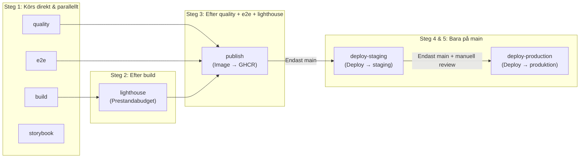

[](https://github.com/vbystroem/Team-Ohm_Kraftly-Mina-Sidor/actions/workflows/ci.yaml)

# Kraftly Mina Sidor

Kundportal för Kraftly. Levereras av Webbmakarna AB.

## Getting started

### Miljövariabler

börja med att kopiera .env filen för att komma åt api nyckeln

```bash
cp .env.example .env

# Detta kopierar innehållet i .env.example till en ny .env fil som inte pushas upp till repot.
```

Nycklarna finns på render.

### Lokalt Med Docker

Kräver Docker och Docker Compose.

```bash
# Bygg och starta alla tjänster (frontend + mock-API)
docker compose up --build

# Portalen är tillgänglig på http://localhost:8080
```

### Staging

Gå in på https://kraftly-ohm-staging.onrender.com för att komma åt stagingmiljön

### Production

Gå in på https://kraftly-ohm.onrender.com för att komma åt produktionsmiljön

### Utan Docker

Kräver Node.js 22+.

```bash
# Installera beroenden
npm install

# Starta mock-API i en terminal
npm run api

# Starta frontend i en annan terminal
npm run dev

# Portalen är tillgänglig på http://localhost:5173
```

### Logga in

Det finns två testkonton som används för att testa appen

### Kund 1 — Anna Andersson

email: anna.andersson@example.com
password: kraftly-anna

### Kund 2 — Bo Bergström

email: bo.bergstrom@example.com
password: kraftly-bo

## Projektstruktur

- `src/` – Vue.js-frontend
- `mock-api/` – Mock-API för lokal utveckling
- `nginx.conf` – Nginx-konfiguration för produktion
- `Dockerfile` – Multi-stage build (Node → nginx)
- `docker-compose.yml` – Lokal utvecklingsmiljö

## Pipeline

Vi har en pipeline under .github/workflows/ci.yml som körs på varje pull request mot main. den ser till att koden följer samma struktur och inte har några grundläggande fel, den sköter också deployment till en staging miljö och en prod miljö.



### Rollback.yml

Vi har också en fil som heter rollack.yml, den kan man köra manuellt i github för att gå tillbaka till en tidigare deploy om så skulle behövas. Det är bara att gå in under Actions-tabben i github för att köra den.

## Beslut

Vi har tagit beslut under projektets gång, dessa finns i docs/decisions, med info om vad vi övervägde och när besluten ska omprövas. Det finns även annan dokumentation som är värd att läsa om du är ny till projektet!

## Dokumentation

| Fil                                                        | Svarar på                                                            |
| ---------------------------------------------------------- | -------------------------------------------------------------------- |
| `docs/architecture.md`                                     | Vad pratar med vad, var kör det, lagren i frontend                   |
| [docs/decisions/](docs/decisions/README.md)                | Varför – ett dokument per beslut, index över projektets beslut       |
| `docs/decisions/deploy.md`                                 | Hur en ändring når staging och prod, var hemligheterna bor, rollback |
| `docs/decisions/containers.md`                             | Hur Docker-imagen är byggd och körs lokalt                           |
| `docs/pipeline.md`                                         | Vad som krävs för att merga, vad man gör när `main` är röd           |
| `docs/readiness.md`                                        | Checklistan _Produktionsfärdig app_ med status per rad               |
| `docs/known-issues.md`                                     | Vad som är känt trasigt eller medvetet ogjort                        |
| `docs/scaling.md`                                          | Lasttester, flaskhalsar och skalningsstrategi                        |
| `docs/testing.md`                                          | Vad som testas var                                                   |
| `docs/security.md`                                         | Inloggningen och OWASP-genomgången                                   |
| `docs/performance.md`                                      | Hur vi mäter, optimeringarna, budgeten i CI                          |
| `docs/accessibility.md`                                    | Komponentbiblioteket, tangentbordsgenomgången                        |
| `docs/ai-in-pipeline.md`                                   | AI-granskningen och vår regel för den                                |
| `docs/sustainability.md`                                   | CO2-siffran och etikfallet                                           |
| `docs/demo.md`                                             | Körschemat för slutdemon                                             |
| `docs/daily_logs/` · `docs/milestones.md` · `docs/debt.md` | Loggen, milstolparna, skulden vi tog över                            |

### Kända brister

Kända brister finns under docs/known-issues.md

# Working agreement

## Schema:

Vi ses 10:00 i skolan på fredagar, och jobbar distans på måndagar och tisdagar. Om något annat är planerat på fredagen ses vi i skolan måndag kl.10.00 veckan efter.

## Pull Requests:

Minst en annan person måste granska koden innan den mergeas till main, vi följer ett PR template som finns i .github>pull_request_template.md

## Kommunikation:

Discord som huvudkanal, där vi sköter all kommunikation.

## Tech Lead (subject to change om Nancy hänger med):

Vecka 1-4: Veronica
Vecka 5-8: Kim
Vecka 9-12: Andryan
