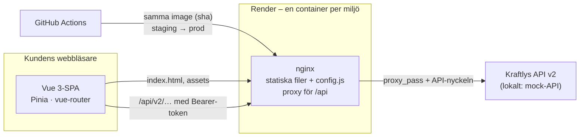

Torsdag - Övning 3: Kraftly dokumenterad – README, arkitekturskiss, beslutsdokument och readiness

Torsdag 29/10, 14:15–15:40 i sal 5 – sedan på egen hand till tisdag · Vecka 11 · Kursmål 11 · I team · = start på M10

Läs så här: först Gemensamt före allt annat (10 min), sedan de tre spåren parallellt. Först, efter lunch, förbereder ni (13:05) och håller övningspresentationerna (13:35). Tabellen Skriv ner längs vägen listar vad som ska vara skrivet när ni taggar – siffran återkommer som (rad N) i spåren.

M10 är dokumentation, inte kod – gjord liten med flit. Rapporten skrivs samma vecka, så i eftermiddag gör ni tre korta spår och inget mer. Inga nya funktioner efter M9 – det är vad feature freeze betyder. CHANGELOG, API-dokumentation, JSDoc och diagram för varje vy utgår ur kursen.

I förmiddags klonade ni ett annat teams repo och försökte komma igång med bara deras README. Samtidigt gjorde de samma sak med ert. Deras issue Nya kollegan-testet 29/10 ligger nu i ert repo, och den är er M10-lista – stoppen de fick, frågorna de inte kunde svara på. Ni har sett vad som saknades hos dem. Nu fixar ni det som saknas hos er.

De fem frågorna, samma som i förmiddags. En ny kollega ska hitta svaren via README på högst 15 minuter, utan att fråga teamet:

    Hur startar jag appen lokalt, och hur vet jag att den fungerar?
    Var bor hemligheterna, och hur får jag dem?
    Hur kommer en ändring till produktion – och hur rullar man tillbaka?
    Varför ser arkitekturen ut så här – var finns besluten?
    Vad är känt trasigt eller medvetet ogjort?

Spår Vem Vad
1 · README och arkitekturskissen 1–2 pers luckorna ur issuen, dokumentationstabellen, docs/architecture.md i Mermaid
2 · Beslutsdokumenten 1 pers de tre viktigaste besluten, det som saknas skrivet, indexet docs/decisions/README.md
3 · Readiness och kända brister 1 pers checklistan i docs/readiness.md med status per rad, docs/known-issues.md

Skriv ner längs vägen: det här är M10:s bevis. Var det hamnar är samma som i Canvas-uppgiftens tabell Bevisen ni behöver – det ni skriver i dag är det ni taggar på tisdag.

# Vad När Var det hamnar Varför

1 Varje stopp och varje obesvarad fråga i partnerteamets issue – och vad som blev av den: PR:en som åtgärdade den, eller raden i docs/known-issues.md Gemensamt, sedan spår 1–3 till tisdag docs/milestones.md under M10 DoD 1 (länk till issuen + PR:arna) DoD 1 kräver att luckorna är åtgärdade eller står som känd brist
2 De fem frågorna: för var och en, var svaret står – rubriken i README eller filen som dokumentationstabellen pekar på spår 1 steg 4 docs/milestones.md under M10 DoD 1, tabellen Fråga · Var svaret står det är beviset för att README klarar nya kollegan-testet
3 Arkitekturskissen, och länken till filen på GitHub där Mermaid renderas spår 1 steg 5–6 docs/architecture.md – Översikt, Lagren i frontend, Miljöer, Beslut en skiss som inte renderas är kod, inte en bild
4 Vilka tre beslut som är viktigast – och varför just de spår 2 steg 1 docs/decisions/README.md DoD 1 kräver minst tre, och viktigast är ett val ni ska kunna motivera
5 Vilket beslut som är efterhandsskrivet, och i vilken vecka det togs spår 2 steg 3 docs/decisions/<ämne>.md, raden Efterhandsskrivet v.11 – beslutet togs i vecka N märkt är ett efterhandsskrivet dokument ärligt – omärkt ser det ut som en efterkonstruktion
6 Status och bevis på varje rad i checklistan spår 3 steg 1–3 docs/readiness.md DoD 2 – och det är filen jag öppnar onsdag 4/11
7 Varje känd brist och saknas: brist, påverkan, varför den inte är åtgärdad (vem äger den, vad det skulle kosta) spår 3 steg 4 docs/known-issues.md – tabellen och Vad vi hade gjort med två veckor till en brist som står skriven är ett val; en som någon annan hittar är ett misstag
8 De fyra punkterna i definitionen av kritisk, var och en kontrollerad – och hur spår 3 steg 5 docs/readiness.md (ingressen) → docs/milestones.md under M10 DoD 2 det kritiska får inte stå kvar, och "inget kritiskt" ska gå att kontrollera
9 Körschemat för slutdemon, demo-ansvarig, flikarna, reserven fredag–måndag, M10 steg 7 docs/demo.md – Körschema, Förberedelser, Om något går fel DoD 3 – mallen står i M10-uppgiften
10 Generalrepetitionen: datum, hur lång den blev, vad som ändrades måndag 2/11 eller tisdag 3/11, M10 steg 8 docs/log.md → länk i docs/milestones.md under M10 DoD 3 DoD 3 – en demo som aldrig körts igenom tar alltid längre tid än papperet säger
Gemensamt före allt annat (10 min)

Varför: det är partnerteamets stopp, inte era egna gissningar, som säger vad README saknar – och utan en plan börjar tre personer skriva i samma fil.

    Läs issuen tillsammans. Tech lead öppnar Nya kollegan-testet 29/10 i ert repo på en skärm. Gå igenom varje stopp och varje fråga de inte kunde svara på.
    Sortera varje punkt till ett spår: README och skissen (spår 1), besluten (spår 2), något som är trasigt eller ogjort (spår 3 – blir en rad i docs/known-issues.md om det inte fixas). Svara på issuen med en kommentar per punkt: vem tar den (rad 1).
    Vem gör vad. Tech lead fördelar spåren och skriver fördelningen i teamtråden. Spår 1 och 3 skriver båda i README:s dokumentationstabell – den som gör spår 1 äger tabellen.
    Ett ord om koden. Står något i issuen som är kritiskt (definitionen står i spår 3) – kunddata kan läcka, inloggningen går att kringgå, prod kan inte rullas tillbaka, eller pipelinen är röd på main – är det den enda kod som ska skrivas den här veckan. Ge den en ägare nu.

Klart när: varje punkt i issuen har en ägare och ett spår, och fördelningen står i teamtråden.
Spår 1 · README och arkitekturskissen (1–2 pers)

Mål: README klarar nya kollegan-testet, och docs/architecture.md visar vad som pratar med vad och var det kör. Varför: README är det första nästa team läser – och skissen är det enda som svarar på fråga 4 utan att man läser koden.

    Luckorna ur issuen. git switch -c docs-readme. Ta partnerteamets stopp ett i taget och rätta README där de fastnade – ett kommando som saknades, en port som var fel, en .env som inte nämndes. Skriv PR-numret bredvid punkten i issuen (rad 1).
    Kom igång på en färsk klon. Klona repot till en ny mapp och följ Kom igång ord för ord – inget du "vet" får användas. Fungerar det inte där, fungerar det inte för nästa kollega heller.
    Dokumentationstabellen. Lägg en tabell under rubriken Dokumentation i README med en rad per fil i docs/ och en rad för docs/decisions/: filen och vilken fråga den svarar på. Spår 3:s två filer och docs/architecture.md finns inte än – skriv raderna nu, så pekar de rätt när filerna kommer.
    De fem frågorna. För var och en: var i README står svaret, eller vilken fil i tabellen pekar dit? Skriv tabellen Fråga · Var svaret står (rad 2). Fråga 2 och 3 är de som brukar saknas – hemligheterna och rollbacken står ofta i docs/deploy.md men nämns inte i README.
    docs/architecture.md. Mallen nedan: Översikt (en Mermaid-flowchart – webbläsaren, CDN/nginx, API:t, och var det kör), Lagren i frontend (tabellen Lager · Ansvar · Regel), Miljöer (dev, staging, prod), Beslut (länkarna till docs/decisions/ – spår 2 säger vilka). Regeln för skissen: lagren och pilarnas riktning, inte varje fil. Kontrollera lagerregeln mot koden innan ni skriver den (receptet har kommandot) – står det "bara stores anropar services" och två vyer gör det ändå, skriv undantaget.
    Renderas den? Pusha grenen, öppna PR:en och öppna filen: Files changed → ⋯ vid docs/architecture.md → View file. GitHub ritar Mermaid-blocken som bilder. Står koden kvar som text: syntaxfel – klistra in blocket i Mermaid Live Editor (mermaid.live) och se var det tar stopp. Skriv länken till filen (rad 3).
    Dokumentation som ljuger. Läs docs/pipeline.md Vad som krävs för att merga mot Settings → Branches (eller Rules) → regeln för main. Står jobbet Storybook från M9 med? Står något där som inte finns längre? Rätta i samma PR.

Receptet – försök själva först

Färsk klon (steg 2) – i mappen bredvid ert repo, så att ni inte rör det ni jobbar i:

git clone https://github.com/<org>/<repo>.git ../kraftly-ny
cd ../kraftly-ny

# följ README:s Kom igång härifrån, ord för ord

cd - && rm -rf ../kraftly-ny # städa när ni är klara

Vilka filer tabellen ska ha (steg 3):

ls docs docs/decisions

Dokumentationstabellen i README – en rad per fil, i den ordning en ny kollega behöver dem. Exemplet är ett teamrepos efter M9; era filer kan heta annat. Tabellen listar det ni faktiskt har i docs/ (det ls ovan visar) – en rad per fil som finns, ingen rad för en fil som inte finns. Har ni till exempel docs/containers.md, docs/cache.md eller docs/scaling.md ska de också med:

## Dokumentation

| Fil                                                   | Svarar på                                                            |
| ----------------------------------------------------- | -------------------------------------------------------------------- |
| `docs/architecture.md`                                | Vad pratar med vad, var kör det, lagren i frontend                   |
| `docs/decisions/`                                     | Varför – ett dokument per beslut, index i `docs/decisions/README.md` |
| `docs/deploy.md`                                      | Hur en ändring når staging och prod, var hemligheterna bor, rollback |
| `docs/pipeline.md`                                    | Vad som krävs för att merga, vad man gör när `main` är röd           |
| `docs/readiness.md`                                   | Checklistan _Produktionsfärdig app_ med status per rad               |
| `docs/known-issues.md`                                | Vad som är känt trasigt eller medvetet ogjort                        |
| `docs/testing.md`                                     | Vad som testas var                                                   |
| `docs/security.md`                                    | Inloggningen och OWASP-genomgången                                   |
| `docs/performance.md`                                 | Hur vi mäter, optimeringarna, budgeten i CI                          |
| `docs/accessibility.md`                               | Komponentbiblioteket, tangentbordsgenomgången                        |
| `docs/ai-in-pipeline.md`                              | AI-granskningen och vår regel för den                                |
| `docs/sustainability.md`                              | CO2-siffran och etikfallet                                           |
| `docs/demo.md`                                        | Körschemat för slutdemon                                             |
| `docs/log.md` · `docs/milestones.md` · `docs/debt.md` | Loggen, milstolparna, skulden vi tog över                            |

De fem frågorna under M10 DoD 1 i docs/milestones.md (steg 4):

| Fråga                                                      | Var svaret står                                    |
| ---------------------------------------------------------- | -------------------------------------------------- |
| 1. Starta lokalt, och hur vet jag att den fungerar?        | README, _Kom igång_ + …                            |
| 2. Var bor hemligheterna, och hur får jag dem?             | …                                                  |
| 3. Hur når en ändring prod – och hur rullar man tillbaka?  | …                                                  |
| 4. Varför ser arkitekturen ut så här – var finns besluten? | `docs/architecture.md`, `docs/decisions/README.md` |
| 5. Vad är känt trasigt eller medvetet ogjort?              | `docs/known-issues.md`, `docs/readiness.md`        |

Lagerregeln mot koden (steg 5) – vilka vyer och komponenter anropar services/ direkt, utan en store?

grep -rn "services/" src/views src/components

Varje träff som hämtar data är ett undantag från "bara stores anropar services" – en träff som bara importerar en felklass (som AuthError i LoginView) är det inte. Skriv regeln som den är, inte som den borde vara – undantaget i Regel-kolumnen, eller som en rad i docs/known-issues.md.

Mallen för docs/architecture.md – skissen är labbrepots (Render, nginx som proxy för API:t). Byt till er verklighet: har ni ett CDN framför nginx blir det en nod till; kör ni något annat än Render heter rutan något annat.

# Arkitektur

## Översikt

<Två–tre meningar: vad appen är (statiska filer bakom nginx, ingen server-rendering –
se docs/decisions/rendering.md) och varför det gör drift och skalning enkelt.>

## Lagren i frontend

| Lager         | Ansvar                                       | Regel                                      |
| ------------- | -------------------------------------------- | ------------------------------------------ |
| `views/`      | Sidorna routern känner till                  | Hämtar data via stores – undantag: …       |
| `components/` | Återanvändbara delar (`KButton`, `KField` …) | Vet ingenting om API:t                     |
| `stores/`     | Tillstånd som delas mellan vyer (Pinia)      | Anropar `services/`                        |
| `services/`   | HTTP mot API:t, token i minnet               | Ingen Vue-kod                              |
| `utils/`      | Rena funktioner                              | Inga sidoeffekter – därför lätta att testa |
| `router/`     | Rutterna och vakten för inloggning           | …                                          |

Beroendena pekar nedåt: vy → store → service. Aldrig tvärtom.

## Ett flöde: inloggningen

<Valfritt – sekvensdiagrammet nedan.>

## Miljöer

| Miljö        | Adress                                        | Uppdateras                                 | Norge-flaggan | API      |
| ------------ | --------------------------------------------- | ------------------------------------------ | ------------- | -------- |
| Dev (lokalt) | http://localhost:8080 (Docker) · :5173 (Vite) | när du vill                                | på            | mock-API |
| Staging      | https://…                                     | varje merge till `main`                    | på            | …        |
| Prod         | https://…                                     | samma image som staging, efter godkännande | av            | …        |

Samma image går genom miljöerna – konfigurationen skiljer dem åt, inte koden.

## Beslut

De tre viktigaste – alla beslut finns i [`docs/decisions/`](decisions/README.md):

- [Hosting](decisions/hosting.md) – en container på Render, imagen byggs en gång
- [Tokenlagring](decisions/tokenlagring.md) – access token i minnet, refresh i httpOnly-cookie
- [Feature flags](decisions/feature-flags.md) – Norge bakom en flagga som läses vid körtid

<Era tre – samma som i docs/decisions/README.md. Exemplet är labbrepots val.>

Sekvensdiagrammet för Ett flöde: inloggningen (valfritt) – byt ut sökvägarna mot era:

sequenceDiagram
participant K as Kunden
participant S as SPA
participant N as nginx
participant A as API v2
K->>S: e-post + lösenord
S->>N: POST /api/v2/auth/login
N->>A: samma anrop + API-nyckeln
A-->>S: access token + refresh-cookie (httpOnly)
Note over S: access token bara i minnet
S->>N: GET /api/v2/user (Bearer)
N->>A: vidare
A-->>S: kundens uppgifter
Note over S,A: access token har gått ut
S->>N: POST /api/v2/auth/refresh (cookien följer med)
N->>A: vidare
A-->>S: ny access token

Mermaid i korthet: flowchart LR ritar från vänster till höger (TB uppifrån och ner). A["text"] är en nod, A --> B en pil, A -->|"etikett"| B en pil med text. subgraph namn["Rubrik"] … end ritar en ram runt noder. Citattecken runt texten när den innehåller /, ( eller . – annars tolkar Mermaid dem som syntax.   ger radbrytning.

Klart när: partnerteamets README-stopp har en PR var (rad 1), Kom igång fungerar på en färsk klon, tabellen Dokumentation finns i README, de fem frågorna har ett var (rad 2), och docs/architecture.md renderas på GitHub med Översikt, Lagren i frontend, Miljöer och Beslut (rad 3).
Spår 2 · Beslutsdokumenten (1 pers)

Mål: projektets tre viktigaste beslut står i docs/decisions/, med alternativen och när de ska omprövas, och ett index visar alla. Varför: besluten är svaret på fråga 4 – och den som tar över ett repo frågar alltid varför gjorde ni så här, oftast precis innan hon gör om det.

    Välj de tre viktigaste. ls docs/decisions/ – de flesta team har rendering.md, tokenlagring.md, hosting.md och feature-flags.md sedan M4–M8. Gå igenom kandidatlistan i receptet. Fråga för varje: vilket beslut skulle vara dyrast att göra om – och vilket ifrågasätter nästa team först? Skriv de tre och en mening om varför just de (rad 4).
    Granska de befintliga mot mallen. Varje dokument ska ha en rad med datum och beslut, Bakgrund, Alternativ vi jämförde, Motivering och Konsekvenser med en rad Omprövas om …. Skriv inte om dokument som fungerar – komplettera det som saknas. Oftast är det alternativen och Omprövas om.
    Skriv det som saknas. Är ett av de tre viktigaste besluten aldrig dokumenterat – grenstrategin och komponentbiblioteket är de vanligaste – skriv det nu i mallen. Märk det med raden Efterhandsskrivet v.11 – beslutet togs i vecka N direkt under datumraden (rad 5). Skriv alternativen ni minns, och säg att ni inte minns resten om det är så.
    Indexet docs/decisions/README.md: tabellen Nr · Beslut · Datum · Status med alla beslut, äldst först, och gäller eller ersatt i statuskolumnen. En mening överst om vilka tre som är viktigast.
    Länka. Ge spår 1 de tre länkarna till Beslut i docs/architecture.md, och kontrollera att README:s dokumentationstabell pekar på docs/decisions/.

Receptet – försök själva först

Klart när: de tre viktigaste besluten är valda och motiverade (rad 4), alla tre har Alternativ vi jämförde och Omprövas om, ett efterhandsskrivet dokument är märkt (rad 5), och docs/decisions/README.md listar alla beslut med status.
Spår 3 · Readiness och kända brister (1 pers)

Mål: checklistan Produktionsfärdig app står i ert repo med en ärlig status och ett bevis på varje rad, och allt som inte är klart står i docs/known-issues.md med påverkan och skäl. Varför: "Inga kända kritiska brister" går bara att påstå om man har gått igenom allt – och en kort lista man kan försvara slår en tom lista någon hittar hål i.

    Klistra in checklistan. git switch -c docs-readiness. Skapa docs/readiness.md med mallen i receptet – hela tabellen ligger där, klar att klistra in.
    Status på varje rad: klart, känd brist, saknas eller utgår (beslut 12/10). Fråga den som gjorde milstolpen om ni är osäkra – kolumnen Kraftly på Canvas-sidan säger vilken. Det som utgick ur kursen 12/10 (stories för samtliga komponenter, axe-test per formulärvy) skrivs utgår (beslut 12/10), inte saknas. Raden Release gäller vecka 12 – den har redan v.12 som status. Rader under Dokumentation blir klart när spår 1 och 2 är mergade (rad 6).
    Bevis på varje rad. Kolumnen Bevis är förifylld med checklistans Så bevisar ni det. Byt ut den mot en länk eller ett filnamn: PR:en, körningen, filen och avsnittet. Hittar ni inget bevis för en rad ni trodde var klart – då är den inte klar (rad 6).
    docs/known-issues.md. En rad per känd brist och per saknas: bristen, påverkan (för vem, hur illa), och varför den inte är åtgärdad – vem äger den och vad det skulle kosta. Sist avsnittet Vad vi hade gjort med två veckor till, i prioritetsordning. Partnerteamets punkter som inte fixas hamnar här också (rad 7).
    Kritiskt? Gå igenom de fyra punkterna i definitionen nedan mot ert repo och er prod – receptet har kommandona. Skriv i ingressen till docs/readiness.md att ingen rad är kritisk och vad ni kontrollerade (rad 8). Hittar ni något kritiskt: det blir en PR före taggen, inte en rad i known-issues.md. Säg till tech lead direkt.

Kritisk = kunddata kan läcka, inloggningen går att kringgå, prod går inte att rulla tillbaka, eller pipelinen är röd på main – sådant får inte stå kvar som "känd brist"; allt annat får det, om det står skrivet.
Receptet – försök själva först

Mallen för docs/readiness.md – hela checklistan, med kolumnerna Status och Bevis. Raderna är ordagrant Canvas-sidans; Bevis är förifylld med Så bevisar ni det och byts ut mot era länkar och filer:

# Readiness – Produktionsfärdig app

<Datum och commit/tagg.> Status per rad i checklistan _Produktionsfärdig app_: klart, känd brist och saknas (båda i `docs/known-issues.md`), utgår (beslut 12/10) för det som ströks ur kursen, eller v.12 för raden _Release_. Ingen rad är kritisk – vi har kontrollerat <de fyra punkterna och hur>.

| Område                             | Punkt                                                 | Status                                                                    | Bevis                                                                                                                                     |
| ---------------------------------- | ----------------------------------------------------- | ------------------------------------------------------------------------- | ----------------------------------------------------------------------------------------------------------------------------------------- |
| **Repo och samarbete**             | Branch protection, PR-mall, CODEOWNERS                | …                                                                         | inställningen i GitHub, en PR som blockerats                                                                                              |
|                                    | Skuldinventering                                      | …                                                                         | `docs/debt.md`                                                                                                                            |
|                                    | Arbetslogg och beslut                                 | …                                                                         | `docs/log.md`, `docs/decisions/`                                                                                                          |
| **Kvalitet**                       | Enhets- och komponenttester                           | …                                                                         | ≥ 10 test, ≥ 1 regressionstest på en bugg ur skulden                                                                                      |
|                                    | Lint och format i pre-commit                          | …                                                                         | en commit som stoppats lokalt                                                                                                             |
|                                    | Teststrategi                                          | …                                                                         | `docs/testing.md`                                                                                                                         |
| **CI**                             | Lint + test + build på varje PR, röd status blockerar | …                                                                         | grön och röd körning länkade, required check                                                                                              |
|                                    | Smoke-test i browsern                                 | …                                                                         | Cypress-jobbet i pipelinen                                                                                                                |
|                                    | Beroendecache med uppmätt vinst                       | …                                                                         | före/efter-tider i `docs/pipeline.md`                                                                                                     |
| **Container**                      | Multi-stage Dockerfile, liten image                   | …                                                                         | `docker images` under 100 MB                                                                                                              |
|                                    | `docker compose up` startar allt                      | …                                                                         | kommandot och vad som startar                                                                                                             |
| **Leverans**                       | Merge till `main` deployar till staging               | …                                                                         | deploy-jobbet, `/version.txt` med sha                                                                                                     |
|                                    | Imagen byggs en gång, taggas med sha                  | …                                                                         | taggen i registret = sha på `main`                                                                                                        |
|                                    | Hemligheter utanför koden, roterade                   | …                                                                         | `git log -S` tomt, nyckeln bara i plattformen                                                                                             |
| **Drift**                          | Prod skild från staging, konfig via variabler         | …                                                                         | samma image, olika variabler                                                                                                              |
|                                    | Feature flag                                          | …                                                                         | flaggan på i staging, av i prod                                                                                                           |
|                                    | Cache-headers på statiska assets                      | …                                                                         | `curl -I` före/efter                                                                                                                      |
|                                    | Rollback genomförd                                    | …                                                                         | logg eller skärmdump av rollbacken                                                                                                        |
|                                    | Skalningsstrategi på egna mätvärden                   | …                                                                         | `docs/scaling.md` med siffror                                                                                                             |
| **Säkerhet**                       | Riktig autentisering, skyddade routes                 | …                                                                         | token-flödet, en route som svarar 401                                                                                                     |
|                                    | OWASP-genomgång                                       | …                                                                         | `docs/security.md`, kolumnen _Kontroll_                                                                                                   |
|                                    | CORS och CSP                                          | …                                                                         | `curl -I` på headrarna                                                                                                                    |
| **Prestanda**                      | Mätmetod skriven ner                                  | …                                                                         | `docs/performance.md`, _Så mäter vi_                                                                                                      |
|                                    | ≥ 3 optimeringar med före/efter                       | …                                                                         | tabellen i `docs/performance.md`                                                                                                          |
|                                    | Budget i CI som stoppar                               | …                                                                         | required check, en röd körning                                                                                                            |
| **Tillgänglighet och komponenter** | Ett komponentbibliotek                                | …                                                                         | `KButton`, inga gamla kvar (M8) · `KField` (M9)                                                                                           |
|                                    | Labels, fokus, kontrast, `lang`, alt, `scope`         | …                                                                         | _Vad vi åtgärdade_ i `docs/accessibility.md`                                                                                              |
|                                    | Storybook och axe lokalt                              | … · _utgår (beslut 12/10)_: stories för samtliga, axe-test per formulärvy | stories för `KButton` och de komponenter ni ändrat, axe-test för `KButton` och inloggningen (M8) · _Violations 0_                         |
|                                    | Tangentbordsgenomgång före/efter                      | …                                                                         | tabellen i `docs/accessibility.md`                                                                                                        |
| **Automation och hållbarhet**      | Storybook-jobbet i pipelinen                          | …                                                                         | jobbet _Storybook_ i pipelinen, required check                                                                                            |
|                                    | AI-steg utvärderat                                    | …                                                                         | tabellen träff / miss / oavgjord på minst tre riktiga PR:ar, två exempel (en träff, en miss) och teamets regel i `docs/ai-in-pipeline.md` |
|                                    | Hållbarhetsanalys med siffror                         | …                                                                         | `docs/sustainability.md`                                                                                                                  |
| **Dokumentation**                  | README, beslutsdokument, arkitekturskiss              | …                                                                         | `docs/` komplett, nya kollegan-testet klarat, `docs/readiness.md` ifylld                                                                  |
|                                    | Inga kända kritiska brister                           | …                                                                         | `docs/known-issues.md` (brist · påverkan · varför), ingen kritisk kvar                                                                    |
| **Release**                        | Taggad release, demo live i prod                      | _v.12_                                                                    | `v1.0`, slutdemon                                                                                                                         |

Så kan tre ifyllda rader se ut:

| | Rollback genomförd | klart | [körningen av Rollback](https://github.com/<org>/<repo>/actions/runs/…), `docs/deploy.md` |
| | Beroendecache med uppmätt vinst | känd brist | `cache: npm` i `ci.yml` – före/efter-tiderna i `docs/pipeline.md` är exempelvärden, se `docs/known-issues.md` rad 4 |
| | Storybook och axe lokalt | klart · _utgår (beslut 12/10)_: stories för samtliga, axe-test per formulärvy | `KButton.stories.js`, `LoginView.a11y.test.js` – _Violations 0_ |

Mallen för docs/known-issues.md:

# Kända brister

Inget här är kritiskt enligt definitionen i M10. Listan finns för att den som tar över ska veta det vi vet.

| #   | Brist                                                                          | Påverkan                                                          | Varför den inte är åtgärdad                                                                                           |
| --- | ------------------------------------------------------------------------------ | ----------------------------------------------------------------- | --------------------------------------------------------------------------------------------------------------------- |
| 1   | Refresh-tokens ligger i API:ts minne                                           | Startar API:t om loggas alla kunder ut och får logga in igen      | API:t ägs av Kraftlys backend-team. I ett riktigt API: en tabell med utgångstid (`docs/security.md`, _Kända brister_) |
| 2   | Ingen visuell regressionstestning                                              | En CSS-ändring kan förstöra en vy utan att något test blir rött   | Storybook finns, och det är förutsättningen – nästa steg, men inte före `v1.0`. <Vad det skulle kosta>                |
| 3   | Ingen skärmläsare provad (VoiceOver, NVDA)                                     | Okänt hur portalen fungerar för de användare som behöver det mest | Ingen genomgång gjord. Kostar en genomgång per vy och verktyg – …                                                     |
| 4   | Byggtiderna i `docs/pipeline.md` är exempelvärden, inte avlästa i vårt Actions | Vinsten med npm-cachen är inte bevisad                            | Att mäta kostar en körning med och en utan cache, avläst i Actions – …                                                |
| …   | …                                                                              | …                                                                 | …                                                                                                                     |

## Vad vi hade gjort med två veckor till

1. <Det som ligger närmast att bli kritiskt – och varför.>
2. …
3. …

Raderna är exempel från labbrepot – kontrollera varje rad mot ert eget repo innan den står kvar. En rad som inte stämmer är värre än ingen rad.

De fyra punkterna i kritisk (steg 5):

# Pipelinen röd på main? Senaste körningarna på main ska vara success

gh run list --branch main --limit 3

# Inloggningen går att kringgå? Ett skyddat anrop utan token ska ge 401

curl -s -o /dev/null -w "%{http_code}\n" https://<er-prod>/api/v2/user

# Kunddata kan läcka? Ingen nyckel i koden som byggs till browsern (tomt svar = bra),

# och säkerhetsheadrarna på plats i prod

git grep -n -i "api_key\|secret\|_sk_" -- src
curl -sI https://<er-prod>/ | grep -i "content-security-policy\|strict-transport"

# Prod går inte att rulla tillbaka? Finns rollbacken, och har den körts?

gh run list --workflow rollback.yml --limit 1

Sökvägen i curl och namnet på rollback-workflowen kan heta annat hos er – docs/deploy.md och docs/security.md säger vad. Kunddata kan också läcka i browsern: logga in i prod, öppna DevTools → Application → Local Storage – där ska inte ligga någon token. Gjorde ni rollbacken i M5 för hand i Render: länka loggen eller skärmdumpen från då.

Klart när: ingen rad i docs/readiness.md saknar status eller bevis (rad 6), varje känd brist och saknas har en rad i docs/known-issues.md med påverkan och skäl (rad 7), och de fyra punkterna i kritisk är kontrollerade och skrivna i ingressen (rad 8).
Fredag–tisdag · docs/demo.md och generalrepetitionen

Varför: demon görs i prod inför beställaren, och den behöver ett körschema att repetera – det skrivs när dokumentationen står, inte i salen i dag.

Körschemat för slutdemon torsdag 5/11 och generalrepetitionen måndag 2/11 eller tisdag 3/11 ligger i M10:s arbetsordning (steg 7 och 8), med mallen för docs/demo.md och hur generalrepetitionen loggas i docs/log.md (rad 9–10). Utse demo-ansvarig innan ni går i dag.
13:35 · Övningspresentationer med kamratrespons (alla, 40 min, före spåren)

Ni sitter i förmiddagens par. Varje person håller 2 minuter om mitt val – valet i rapportens del 2 – med strukturen problem → val → bevis (en siffra) → vad jag hade gjort annorlunda. Partnern ger respons enligt Canvas-sidan Kamratrespons – mall. Byt roller, och kör sedan ett varv till med en ny partner. Ta emot responsen utan att försvara dig.
Ni är klara i salen (16:00) när

    Varje punkt i partnerteamets issue har en ägare och ett svar i issuen (rad 1).
    Spår 1: dokumentationstabellen finns i README och docs/architecture.md ligger i en PR med skissen renderad (rad 2–3).
    Spår 2: de tre viktigaste besluten är valda och indexet är påbörjat (rad 4).
    Spår 3: docs/readiness.md har status på varje rad (rad 6), och de fyra punkterna i kritisk är kontrollerade (rad 8).
    Demo-ansvarig är utsedd, och alla har hållit sina två minuter och skrivit ner en sak att ändra.

Till taggen (tisdag 3/11)

    Rad 1–8 i Skriv ner längs vägen klara och mergade, och issuen från partnerteamet stängd med en kommentar per punkt.
    Rad 9–10: docs/demo.md skrivet och generalrepetitionen loggad – M10:s arbetsordning, steg 7–8.
    Alla DoD-punkter i M10-uppgiften, med bevisen under punkterna i docs/milestones.md.
    Tagg M10 tisdag 3/11 23:59 – samma kväll som rapporten. Uppföljning onsdag 4/11.

Klart att peka på för var och en: en PR du öppnat under M10, eller ett dokument du skrev – och vilken av de fem frågorna det svarar på.

---

M10 – Feature freeze

    Inlämningsdatum Tisdag av 23.59 Poäng 0 Lämnar in en textimatningsruta

Läs så här: först målet, sedan Bevisen ni behöver (vad som ska finnas när ni taggar, och var), sedan Arbetsordning (vad ni gör i vilken ordning, torsdag till tisdag), sedan Definition of Done att bocka av. Mallarna för README-tabellen, arkitekturskissen, beslutsdokumenten, docs/readiness.md och docs/known-issues.md står i övning 3 från torsdagen. Mallen för docs/demo.md och generalrepetitionen står här, under Vad ni skriver.

Mål: en ny kollega – eller nästa team – kan ta över ert repo utan att fråga er. README får henne igång och svarar på de fem frågorna nedan. Arkitekturskissen visar vad som pratar med vad och var det kör. De tre viktigaste besluten står med sina alternativ. Checklistan Produktionsfärdig app har en ärlig status på varje rad, och det som inte är klart står skrivet med påverkan och skäl. Och slutdemon torsdag 5/11 är planerad och genomkörd en gång.

    I augusti tog ni över en portal från Webbmakarna AB med en README och inte en rad om varför. Nu är det ni som lämnar över.

M10 är dokumentation, inte kod – gjord liten med flit. Rapporten skrivs samma vecka, så det här är allt. Feature freeze betyder att inga nya funktioner kommer in efter M9: fixar av brister och dokumentation går in, nya funktioner gör det inte. Det här utgår ur kursen och är inte bortglömt: CHANGELOG, API-dokumentation, JSDoc och diagram för varje vy. Inga nya kontroller i pipelinen. Räkna med 6–8 timmar för ett team på tre, och de flesta beslutsdokumenten har ni redan.

Raderna under Dokumentation (README, beslutsdokument, arkitekturskiss och Inga kända kritiska brister) och raden Arbetslogg och beslut under Repo och samarbete på Canvas-sidan Produktionsfärdig app – checklistan (överst i Vecka 42-blocket) är det M10 bockar av – och i M10 kopierar ni hela tabellen till docs/readiness.md.

De fem frågorna i nya kollegan-testet. En person utanför teamet ska, med bara README (direkt eller via dokumentationstabellen) och på högst 15 minuter, kunna svara på:

    Hur startar jag appen lokalt, och hur vet jag att den fungerar?
    Var bor hemligheterna, och hur får jag dem?
    Hur kommer en ändring till produktion – och hur rullar man tillbaka?
    Varför ser arkitekturen ut så här – var finns besluten?
    Vad är känt trasigt eller medvetet ogjort?

Det är det testet partnerteamet gjorde på ert repo i torsdags förmiddag (övning 1). Deras issue Nya kollegan-testet 29/10 är er M10-lista.
Bevisen ni behöver

Allt nedan ska finnas på main när taggen sätts. B-numret är samma som DoD-punktens nummer, och kolumnen Bevis i arbetsordningen pekar hit. Kolumnen längst till höger säger vilken rad i torsdagens övning 3 (Skriv ner längs vägen) som ger beviset.
Bevis Vad Form Var Från övning 3
B1 Dokumentationen komplett: README klarar nya kollegan-testet, arkitekturskissen, minst tre beslutsdokument med index länk till partnerteamets issue och, per stopp i den, PR:en som åtgärdade det eller raden i docs/known-issues.md · tabellen Fråga · Var svaret står för de fem frågorna · README:s dokumentationstabell · docs/architecture.md med skissen (länk till filen på GitHub, där Mermaid renderas) · indexet över besluten, med de tre viktigaste docs/milestones.md under M10 DoD 1 · README, Dokumentation · docs/architecture.md – Översikt, Lagren i frontend, Miljöer, Beslut · docs/decisions/README.md rad 1–5
B2 Inga kända kritiska brister checklistan med Status och Bevis på varje rad · en rad per känd brist och saknas: brist, påverkan, varför den inte är åtgärdad · en mening om att inget kritiskt står kvar, med de fyra punkterna i definitionen genomgångna docs/readiness.md · docs/known-issues.md – tabellen och Vad vi hade gjort med två veckor till · docs/milestones.md under M10 DoD 2 rad 6–8
B3 Demon förberedd körschemat för slutdemon (minut, vad, vem, vad som ska synas), förberedelserna och reservplanen · generalrepetitionen: datum, hur lång den blev, vad som ändrades · demo-ansvarig docs/demo.md – Körschema, Förberedelser, Om något går fel · docs/log.md → länk i docs/milestones.md under M10 DoD 3 rad 9–10
Arbetsordning

# Steg Vem Klart när Bevis

1 Nya kollegan-testet (torsdag förmiddag, övning 1): partnerteamet klonar ert repo och följer README – ni gör samma sak på deras. Issuen landar i ert repo partnerteamet · tech lead tar emot 11:30 issuen Nya kollegan-testet 29/10 finns i ert repo och tech lead har gått igenom den med paret B1
2 Gemensamt (torsdag 14:15, övning 3): läs issuen tillsammans och dela upp den på de tre spåren. Först – det är partnerteamets stopp, inte era gissningar, som säger vad README saknar hela teamet varje punkt i issuen har en ägare B1
3 README + docs/architecture.md (torsdag, övning 3 spår 1): luckorna ur issuen, dokumentationstabellen, arkitekturskissen i Mermaid 1–2 pers skissen renderas på GitHub och README:s tabell pekar på allt i docs/ B1
4 Beslutsdokumenten (torsdag, övning 3 spår 2): de tre viktigaste valda, det som saknas skrivet, indexet 1 pers docs/decisions/README.md listar minst tre beslut, alla med Alternativ vi jämförde och Omprövas om B1
5 docs/readiness.md + docs/known-issues.md (torsdag, övning 3 spår 3): checklistan inklistrad, status och bevis per rad, en rad i known-issues.md per känd brist och saknas 1 pers ingen rad i readiness saknar status B2
6 Det kritiska först (fredag): står något som är kritiskt enligt definitionen i DoD 2 – fixa det via PR innan något annat. Det är den enda kod som ska in den här veckan den som äger raden ingen rad som är kritisk står kvar som känd brist B2
7 docs/demo.md (fredag–måndag): körschemat för slutdemon, vem visar vad, flikarna, reservplanen. Demo-ansvarig utsedd demo-ansvarig + tech lead körschemat ryms på 10 minuter på papperet och reserven är gjord (skärmdumpar eller inspelning) B3
8 Generalrepetitionen (måndag 2/11 eller tisdag 3/11): hela demon en gång, i prod, med klocka – sedan rättar ni körschemat hela teamet anteckningen står i docs/log.md: datum, hur lång den blev, vad som ändrades B3
9 Stäng issuen från partnerteamet: en kommentar per punkt – åtgärdad i #… eller känd brist, rad N i docs/known-issues.md tech lead issuen är stängd och varje stopp har ett svar B1
10 Bocka av DoD, klistra in bevisen, tagga tech lead taggen M10 på main med grön pipeline alla

Fredag till måndag delar ni tiden med rapporten. Gör steg 6 först, steg 7 före helgen om ni kan – generalrepetitionen kräver ett körschema att repetera.

Varje ändring blir en egen PR, som vanligt, även när den bara är dokumentation. AI-granskningen kommenterar bara ändringar under src/, så dokumentations-PR:arna granskar ni själva.
Vad ni skriver

Sju filer. De flesta finns redan, och flera av dem behöver bara kompletteras:

    README – luckorna ur partnerteamets issue åtgärdade, och en dokumentationstabell under rubriken Dokumentation som pekar på varje fil i docs/ och på docs/decisions/. Mallen står i övning 3 spår 1.
    docs/architecture.md – Översikt (Mermaid-flowchart: webbläsare → CDN/nginx → API, och var det kör), Lagren i frontend (tabell Lager · Ansvar · Regel), Miljöer (tabell dev/staging/prod), Beslut (länkar till docs/decisions/). Ett flöde: inloggningen (Mermaid-sekvensdiagram) är valfritt. Mallen står i övning 3 spår 1.
    docs/decisions/README.md + minst tre beslutsdokument – indexet (Nr · Beslut · Datum · Status) och ett dokument per beslut i mallen Datum · Beslut · Bakgrund · Alternativ vi jämförde · Motivering · Konsekvenser (Omprövas om …). Befintliga räknas. Ett efterhandsskrivet beslut märks med raden Efterhandsskrivet v.11 – beslutet togs i vecka N. Mallen och kandidatlistan står i övning 3 spår 2.
    docs/readiness.md – två meningars ingress och hela checklistan som tabellen Område · Punkt · Status · Bevis. Status är klart, känd brist, saknas eller utgår (beslut 12/10); raden Release gäller vecka 12 och får status v.12. Mallen, med hela tabellen färdig att klistra in, står i övning 3 spår 3.
    docs/known-issues.md – tabellen # · Brist · Påverkan · Varför den inte är åtgärdad och avsnittet Vad vi hade gjort med två veckor till. Mallen står i övning 3 spår 3.
    docs/demo.md – körschemat för slutdemon, mallen nedan. Generalrepetitionen loggas i docs/log.md, som ni redan har.
    docs/milestones.md – rubriken M10 med DoD-punkterna nedan och beviset inklistrat under varje.

Mallen för docs/demo.md:

# Slutdemo torsdag 5/11

**Demo-ansvarig:** … · **Miljö:** prod – <url> · **Tid:** 10 min demo + 5 min frågor · **Version:** `v1.0`

## Körschema

| Minut | Vad                                                    | Vem  | Vad som ska synas                 |
| ----- | ------------------------------------------------------ | ---- | --------------------------------- |
| 0–1   | Vad vi tog över – och vad det kostade beställaren      | …    | <t.ex. tre rader ur docs/debt.md> |
| 1–…   | <ett demo-ögonblick per område – ett, inte en rundtur> | …    | <fliken, sidan, siffran>          |
| …–9   | Vad vi inte gjorde                                     | …    | docs/known-issues.md              |
| 9–10  | Sammanfattning: vad portalen klarar i dag              | …    | <prod, en sak>                    |
| 10–15 | Frågor                                                 | alla | –                                 |

## Förberedelser

- [ ] Prod verifierad samma morgon – `/version.txt` visar sha:n för `v1.0`
- [ ] Prod väckt tio minuter före (Render sover efter 15 minuter utan trafik)
- [ ] Flikarna öppna, i ordning: …
- [ ] Inloggad med testkontot i en flik, utloggad i en annan
- [ ] Reserven på skrivbordet: skärmdumpar av varje demo-ögonblick, eller en inspelning
- [ ] Det som ska skrivas live finns att kopiera

## Om något går fel

| Om                         | Då                                                                          |
| -------------------------- | --------------------------------------------------------------------------- |
| Prod svarar inte           | <reserven: skärmdumparna eller inspelningen – och säg vad som skulle synas> |
| Inloggningen fungerar inte | …                                                                           |
| Nätet dör                  | …                                                                           |
| Vi är efter i tid          | <vilket moment som stryks först>                                            |

Körschemat börjar med det beställaren frågar efter – vad det ger, vad det kostar, vad ni riskerar – och går sedan ner i hur. Det är samma ordning som i klipp 2 och i rapportens del 1.

Generalrepetitionen i docs/log.md:

## 2026-11-0… – generalrepetition slutdemon

- Vilka var med: …
- Hur lång den blev: … min (mål 10)
- Vad som ändrades i körschemat: …
- Reserven provad: ja / nej – …

Definition of Done

Bocka av i docs/milestones.md under rubriken M10. Alla punkter ska vara uppfyllda på main när taggen sätts.

    [ ] Dokumentationen komplett: README klarar nya kollegan-testet – en person utanför teamet startar appen lokalt med bara README och kan svara på de fem frågorna med bara repot; luckorna från torsdagens övning 1 (partnerteamets issue) är åtgärdade eller står som känd brist · docs/architecture.md med en arkitekturskiss i Mermaid (vad pratar med vad: webbläsare → CDN/nginx → API; miljöerna dev/staging/prod) och lagren i frontend · minst tre beslutsdokument i docs/decisions/ för projektets tre viktigaste beslut, i mallen Datum · Beslut · Bakgrund · Alternativ · Motivering · Konsekvenser (omprövas om …) – befintliga räknas; ett efterhandsskrivet beslut märks med raden "Efterhandsskrivet v.11 – beslutet togs i vecka N" · README har en dokumentationstabell som pekar på allt i docs/
    [ ] Inga kända kritiska brister: docs/readiness.md = tabellen från Canvas-sidan Produktionsfärdig app – checklistan med en kolumn Status per rad: klart · känd brist · saknas – och utgår (beslut 12/10) för det som utgick, v.12 för raden Release (+ en kolumn Bevis med länk eller fil) · docs/known-issues.md med en rad per känd brist och saknas: brist, påverkan, varför den inte är åtgärdad (vem äger den, vad det skulle kosta) · Kritisk = kunddata kan läcka, inloggningen går att kringgå, prod går inte att rulla tillbaka, eller pipelinen är röd på main – sådant får inte stå kvar som "känd brist"; allt annat får det, om det står skrivet
    [ ] Demon förberedd: docs/demo.md = körschema för slutdemon torsdag 5/11 (10 min demo + 5 min frågor per team): ordningen, vem visar vad, i prod, vilka flikar som ska vara öppna, reservplan (skärmdump eller inspelning om prod sover) · en generalrepetition genomförd måndag 2/11 eller tisdag 3/11 och loggad i docs/log.md (datum, hur lång den blev, vad som ändrades) · demo-ansvarig utsedd (i team om fyra: den som inte varit tech lead)

Det som utgick ur kursen 12/10 – stories för samtliga komponenter och ett axe-test per formulärvy – skrivs utgår (beslut 12/10) i docs/readiness.md, inte saknas, och hör inte hemma i docs/known-issues.md.

Valfritt (räknas inte i DoD): sekvensdiagrammet Ett flöde: inloggningen i docs/architecture.md · nya kollegan-testet en gång till efter era ändringar, av någon som inte var med i torsdags, på en färsk klon – med tiden inskriven · en rad i docs/known-issues.md om dokumentation ni vet är inaktuell och varför den får vara det.
Så här taggar ni

Tech lead, på main, efter att sista PR:en mergats och pipelinen på main är grön:

git checkout main && git pull
npm ci
npm run test:run
npm run build
gh run list --branch main --limit 1 # senaste körningen på main: completed, success
grep -o 'docs/[A-Za-z0-9/_.-]*' README.md | sort -u | xargs ls -d # varje fil README pekar på finns
git tag -a M10 -m "M10 – Feature freeze"
git push origin M10

Skriver ls No such file or directory pekar README på en fil som inte finns – rätta README innan ni taggar. Kontrollera under Tags att M10 finns. Upptäcker ni något efter taggen: fixa via PR, flytta inte taggen.
Inlämning i Canvas – enskilt

Alla i teamet lämnar in var för sig, som text, senast tisdag 23:59:

    Länk till teamets repo
    Länk till taggen (https://github.com/<org>/<repo>/releases/tag/M10)
    Ditt bidrag: länk till en PR som du öppnat under M10, eller till ett dokument som du skrev – plus en mening om vad det svarar på och för vem. README, arkitekturskissen, ett beslutsdokument, readiness, kända brister, körschemat – allt räknas, men det ska gå att peka på

Vad som händer på onsdag 4/11

Onsdag 4/11 är VG-passens dag, så uppföljningen är kort och utan teamrunda. Jag öppnar två saker i varje teamrepo: taggen M10 och docs/readiness.md. Står en rad utan status, eller något som är kritiskt enligt definitionen som känd brist, skriver jag det i er inlämning – det ska vara åtgärdat före v1.0.
Vanliga missar – kolla innan ni taggar

    docs/readiness.md där varje rad är klart. En checklista utan en enda känd brist är inte ett bevis, den är en gissning – och den som tar över hittar hålen själv. De flesta team har minst två ärliga känd brist
    Saknas på det som utgick 12/10. Stories för samtliga komponenter och axe-test per formulärvy togs bort ur kursen – skriv utgår (beslut 12/10), så att det inte ser ut som något ni missat
    Beslutsdokument utan alternativ och utan Omprövas om. Ett beslut utan alternativ är en beskrivning, och utan Omprövas om vet nästa team inte när det får ändra sig. Gäller befintliga dokument också – komplettera dem
    Ett efterhandsskrivet beslut som låtsas vara skrivet då. Motiveringen är rekonstruerad och alternativen delvis glömda – det är okej, men skriv raden Efterhandsskrivet v.11 – beslutet togs i vecka N
    En arkitekturskiss som ritar varje fil. Skissen svarar på vad pratar med vad, och var kör det – lagren och pilarnas riktning, inte src/ i trädform
    docs/demo.md utan reservplan. Render sover efter 15 minuter utan trafik, och nätet i salen är inte ert. Skärmdumparna eller inspelningen ska finnas innan torsdag, inte "om det behövs"
    Nya funktioner efter M9. Feature freeze betyder att det som demas 5/11 är det som fanns vid M9, plus fixar. En ny funktion veckan före demon är den som går sönder på scenen
    README som pekar på filer som inte finns, eller docs/pipeline.md som inte nämner jobbet Storybook från M9. Dokumentation som ljuger är värre än dokumentation som saknas – kör kontrollerna under Så här taggar ni

Efter M10

Nästa vecka är sista veckan. Onsdag 4/11 är VG-passen, för er som anmält er. v1.0 taggas senast torsdag 5/11 kl. 09:00 – det som demas är v1.0. Torsdag 5/11 förmiddag är slutdemon per team, 10 minuter demo + 5 minuter frågor, i prod, enligt ert docs/demo.md; eftermiddagen är de individuella presentationerna, 5 minuter + 3 minuter följdfrågor. Ordningen står på Canvas-sidan Torsdag 5/11 – slutdemo och presentationer. Slutinlämningen med självskattningsmatrisen (moment 2) lämnas i Canvas senast fredag 6/11 kl. 23:59.
