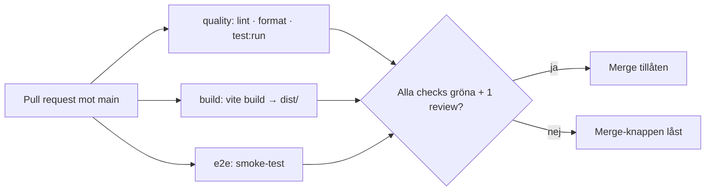

Övning 3 – Teamarbete och workshop Kraftlys pipeline

Torsdag 3/9, 13:10–15:30 · Vecka 3 · Kursmål 2, 5 · I teamet, i Kraftly-repot · Startskottet för M2 (tagg tisdag 8/9)

Förmiddagen var övning på ett sandlåderepo. Nu gör ni samma sak i teamets kodbas – men här finns redan lint, format-check, test:run och ett smoke-test sedan M1, så pipelinen blir på riktigt. Det här är montering, inte författande: receptet nedan är komplett, er uppgift är att få det att passa er kodbas, mäta det, och skriva ner besluten.

Tech lead fördelar spåren direkt kl. 13:10. Alla spår går via PR.
13:10–14:30 · Tre spår
Spår 1 · Pipelinen (2 personer)

Skapa .github/workflows/ci.yml på en branch. Börja med bara jobbet quality – få det grönt först, lägg sedan till build. Kör lokalt innan ni pushar: npm run lint && npm run format:check && npm run test:run && npm run build. Är något rött lokalt blir det rött i CI – fixa lokalt först.

name: CI

on:
pull_request:
push:
branches: [main]

permissions:
contents: read

concurrency:
group: ci-${{ github.ref }}
cancel-in-progress: true

jobs:
quality:
runs-on: ubuntu-latest
steps: - uses: actions/checkout@v4 - uses: actions/setup-node@v4
with:
node-version: 22
cache: npm - run: npm ci - run: npm run lint - run: npm run format:check - run: npm run test:run

build:
runs-on: ubuntu-latest
steps: - uses: actions/checkout@v4 - uses: actions/setup-node@v4
with:
node-version: 22
cache: npm - run: npm ci - run: npm run build - uses: actions/upload-artifact@v4
with:
name: dist
path: dist
retention-days: 7

Två rader ni inte såg i förmiddags, båda värda att förstå: permissions: contents: read ger pipelinen minsta möjliga rättigheter (den ska läsa repot, inget annat – tänk på veckans incident). concurrency med cancel-in-progress avbryter en pågående körning när ni pushar igen till samma PR – sparar minuter i kön.

Mätningen (M2-krav). Kör pipelinen först utan raden cache: npm (kommentera bort den), läs av tiden för npm ci i båda jobben. Lägg tillbaka raden, kör två gånger (första gången fylls cachen). Läs av igen. Skriv in siffrorna i docs/pipeline.md (mall nedan). Ta skärmdumpar av stegtiderna – de går in i docs.
Spår 2 · E2E-jobbet (1–2 personer)

Ert smoke-test från Boiler Room ska köra som ett eget jobb. Vilken variant beror på beslutet i docs/decisions/e2e-verktyg.md.

Playwright:

e2e:
runs-on: ubuntu-latest
env:
CYPRESS_INSTALL_BINARY: 0 # om Cypress ligger kvar i devDependencies: ladda inte ner binären i onödan
steps: - uses: actions/checkout@v4 - uses: actions/setup-node@v4
with:
node-version: 22
cache: npm - run: npm ci - run: npx playwright install --with-deps chromium - run: npm run e2e:pw - uses: actions/upload-artifact@v4
if: failure()
with:
name: playwright-report
path: playwright-report

--with-deps installerar webbläsarens systembibliotek på runnern – utan det får ni ett kryptiskt fel om saknade .so-filer. Rapporten laddas bara upp när det gick fel (if: failure()) – då finns skärmdumpar och trace att ladda ner.

    Kom ihåg Playwright-fixen från Slack: include: ['src/**/*.test.js'] i test-blocket i vite.config.js, annars försöker Vitest köra e2e/*.spec.js i quality-jobbet.

Cypress:

e2e:
runs-on: ubuntu-latest
steps: - uses: actions/checkout@v4 - uses: actions/setup-node@v4
with:
node-version: 22
cache: npm - run: npm ci - run: npm run e2e:cy - uses: actions/upload-artifact@v4
if: failure()
with:
name: cypress-screenshots
path: cypress/screenshots

e2e:cy är start-server-and-test-scriptet från Boiler Room: startar mock-API + dev-server, väntar tills de svarar, kör cypress run. Exakt därför skrev ni det. Cypress-binären laddas ner vid npm ci (~1 min); vill ni cacha den finns cypress-io/github-action@v6 som gör install + cache åt er – stretch.

Frågan ni ska kunna svara på: ska e2e köra parallellt med quality/build eller vänta på dem (needs:)? Parallellt = snabbast svar. I serie = E2E-minuter slösas inte på en PR som ändå har lintfel. Det är beslut 1 i workshopen – prova ena, resonera, skriv ner.
Spår 3 · Grinden och plaketten (1 person, börjar när spår 1 har en grön körning)

    Ruleset på main (Settings → Rules → Rulesets → New branch ruleset): require pull request med 1 approval, required status checks = alla era jobb (quality, build, e2e), require branches to be up to date. Bypass list tom – det gäller tech lead också.
    Verifiera live: öppna en PR med ett medvetet lintfel. Merge-knappen ska vara låst. Skärmdump → docs/pipeline.md. Fixa, grönt, merga.
    Badge överst i README (PR).
    Privat repo på gratiskonto? Rulesets fungerar inte. Två utvägar: gör repot publikt (portalen innehåller inga riktiga hemligheter – nyckeln i api.js är fejk och står redan på er skuldlista), eller aktivera GitHub Student Developer Pack (Pro). Prata med mig om ni är osäkra.

Teamrundor

13:35 – vad står still? Setup, YAML-indrag, rulesets som inte går att spara. 14:15 – visa mig en röd PR. Peka i loggen på raden som säger varför. Alla i teamet ska kunna göra det, inte bara den som skrev workflowen.
14:45–15:30 · Workshop: tre beslut och ett dokument

Samla teamet. docs/pipeline.md är M2:s dokumentationskrav – och som testing.md förra veckan räknas bara det som handlar om er pipeline. Mall:

# Pipeline – Kraftly Mina sidor

## Flöde

## Beslut 1 · Jobb: parallellt eller i serie?

Hur ni delade upp jobben och varför. Vad kostar det i minuter, vad ger det i svarstid?

## Beslut 2 · Vad krävs för merge?

Vilka checks är required, hur många approvals, up to date ja/nej, bypass för någon?

## Beslut 3 · Protokoll vid röd main

Vem gör vad, inom vilken tid. Laga framåt eller revert – var går gränsen? (Aldrig runt.)

## Byggtid: före och efter npm-cache

| Steg             | Utan cache | Med cache |
| ---------------- | ---------- | --------- |
| npm ci (quality) |            |           |
| npm ci (build)   |            |           |
| Hela körningen   |            |           |

Skärmdumpar: …

## Skärmdump: låst merge-knapp

…

Diagrammet ska visa ert flöde – ändra det så det stämmer (kör e2e i serie? rita pilen från build). GitHub renderar Mermaid direkt i markdown, så ni ser resultatet i PR:en.

Jag lyssnar in på beslut 3 hos varje team. Det är det beslutet som avgör om pipelinen är en grind eller en varningslampa om tre veckor: vad händer den första fredagen main är röd och alla vill hem?

Team som blir klara: PR på dokumentet, tech lead granskar. Sedan börjar det riktiga M2-arbetet – DoD:n står i Canvas.
Stretch (för team som är i mål före 15:30)

    Testa artefakten, inte källkoden. Låt e2e vänta på build (needs: build), hämta dist med actions/download-artifact@v4 och kör testerna mot vite preview i stället för dev-servern. Det är samma filer som senare deployas – "bygg en gång, testa det du bygger". Kräver en liten ändring i playwright.config.js (webServer-kommandot). Fråga mig.
    Pinna actions på SHA i stället för @v4 – veckans incident i praktiken. actions/checkout@<commit-sha> # v4.2.2. Vad förlorar ni i bekvämlighet, vad vinner ni?

---

M2 – CI på plats

    Inlämningsdatum 8 Sep av 23.59 Poäng 0 Lämnar in en textimatningsruta

Tredje milstolpen i Kraftly-projektet. Målet: ingen kod når main utan att en maskin har bevisat att den bygger och klarar era tester. Det ni satte upp i M1 – lint, format, testsvit, smoke-test – körs från och med nu automatiskt på varje pull request, i en neutral miljö, och en röd status låser merge-knappen. Regeln från vecka 1, "ingen kod in utan review", får sitt andra lager: ingen kod in utan grön status.
Definition of Done

Bocka av i docs/milestones.md under rubriken M2. Alla punkter ska vara uppfyllda på main när taggen sätts:

    Workflow i .github/workflows/ci.yml som körs på varje pull request mot main och på varje push till main, med lint, format-check, test:run och build – alla gröna på main
    Smoke-testet som eget jobb – Cypress eller Playwright enligt ert beslutsdokument från Boiler Room, grönt i CI
    Branch protection på main (ruleset): pull request krävs, minst 1 approval, alla era jobb som required status checks, "require branches to be up to date". Bypass-listan tom – tech lead ingår i regeln
    Bevis på att grinden fungerar: en PR i historiken där statusen var röd och merge-knappen låst, som sedan blev grön och mergades. Länka den från docs/pipeline.md
    npm-cache aktiverad och uppmätt: tiden för npm ci (och hela körningen) före och efter, med skärmdumpar, i docs/pipeline.md
    docs/pipeline.md enligt strukturen från workshopen: Mermaid-diagram över ert flöde, tre beslut (jobbindelning, mergekrav, protokoll vid röd main), mätvärdena, skärmdump av låst merge-knapp
    CI-badge överst i README som visar passing
    Logg i docs/log.md: en post per arbetsdag, inklusive vem som gjorde vad

Byggartefakten (dist via upload-artifact) är med i receptet från torsdagen och ska finnas kvar – den blir grunden för containern i M3 – men den är inte en egen DoD-punkt.
Så taggar ni M2

Tech lead, på main, efter att sista PR:en mergats och pipelinen på main är grön:

git checkout main && git pull

# Actions-fliken: senaste körningen på main är grön? Annars är ni inte klara.

git tag -a M2 -m "M2 – CI på plats"
git push origin M2

Kontrollera under Tags att M2 finns och pekar på en commit med grön status. Upptäcker ni något efter taggen: fixa via PR, flytta inte taggen, skriv i loggen.
Inlämning – enskilt, precis som M0 och M1

Var och en i teamet lämnar in som text, senast tisdag 23:59:

    Länk till teamets repo på GitHub
    Länk till taggen (https://github.com/<org>/<repo>/releases/tag/M2)
    Ditt bidrag: länk till en PR som du öppnat under M2, där man ser att era checks körde – plus en mening om vad PR:en gjorde och om den var röd någon gång

Punkt 3 är samma fråga som självskattningsmatrisen ställer i slutet av kursen: var i underlaget syns ditt arbete. Ett CI-jobb du satte upp, en cache-mätning du gjorde, ett beslut du skrev – allt räknas, men det ska gå att peka på.
Tech lead-bytet

Rotationen sker var tredje eller var fjärde vecka beroende på om teamet består av tre eller fyra medlemmar. Är ni fyra i gruppen tar nästa tech lead över inför M3. Den avgående tech leaden skriver en kort överlämning i docs/log.md: vad som är igång, vad som skaver och vilket beslut som närmast behöver omprövas. Den nya tech leaden presenterar sig på onsdagens avstämning. Vem som tar över bestämmer ni själva – men det ska stå i loggen senast tisdag.
Vad som händer på onsdag 9/9

Teamrunda ~5 min per team, plus check-in 2 i Mentimeter. Tre saker jag ber om: visa mig en PR som var röd och peka i loggen på raden som sa varför · hur mycket sparade cachen – siffrorna, inte "en del" · läs upp ert protokoll vid röd main på 30 sekunder. Alla i teamet, inte bara den som skrev workflowen.
Vanliga missar – kolla innan ni taggar

    Workflowen ligger i .github/workflow/ (singular) eller heter .yaml när ni skrev .yml i badge-länken – kolla sökvägen tecken för tecken
    lint är grönt lokalt men rött i CI: ni har --fix i editorn men inte committat resultatet. Kör npm run lint i ett rent klon
    Playwright-team: test:run röd med "Playwright Test did not expect test() to be called here" → include: ['src/**/*.test.js'] i test-blocket i vite.config.js
    Playwright-jobbet failar på saknade systembibliotek → npx playwright install --with-deps chromium, inte bara install
    Cypress-jobbet hänger → dev-servern startades aldrig; kör npm run e2e:cy (start-server-and-test), inte cypress run direkt
    verify/quality går inte att välja som required check → checken måste ha kört minst en gång på repot
    Rulesets går inte att aktivera → privat repo på gratiskonto. Publikt repo eller GitHub Student Developer Pack
    Cache-mätningen visar ingen skillnad → ni läste av första körningen efter att cachen slogs på (den fyller cachen). Kör en gång till
    docs/pipeline.md beskriver hur GitHub Actions fungerar i allmänhet i stället för er pipeline – diagrammet, besluten och siffrorna är det som räknas
    Taggen satt när pipelinen på main är röd – då är ni per definition inte klara

Efter M2

Måndag 7/9 kommer veckobriefen för vecka 4: containerteknik. Förstudierna (Docker) ligger redan i Canvas. Torsdag 10/9 containeriserar vi portalen – och artefakten er pipeline bygger i dag är exakt det som ska in i imagen. M3 taggas tisdag 15/9.
