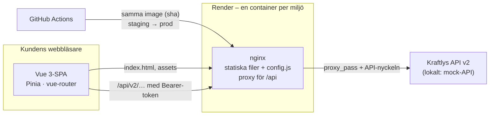
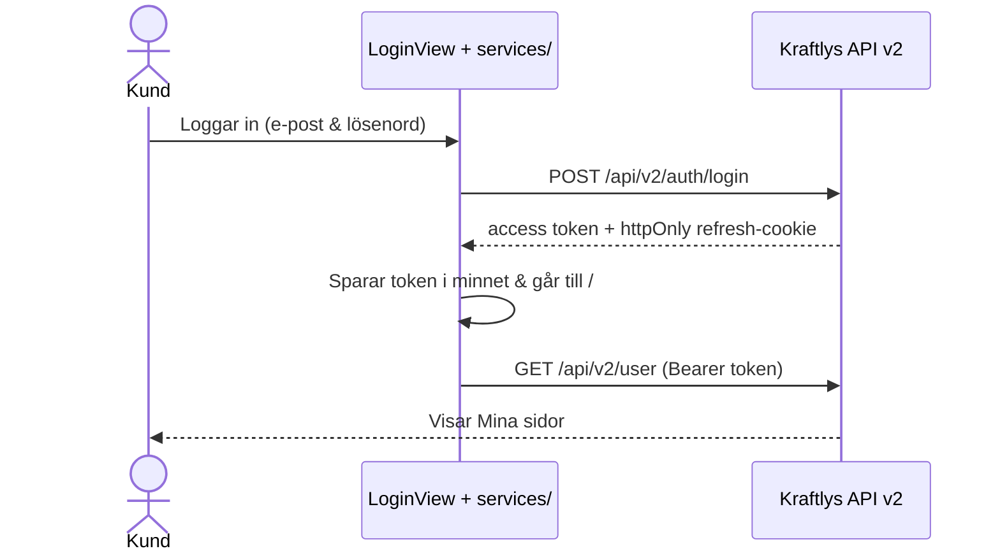

# Arkitektur

## Översikt

Appen är en Vue 3-SPA som byggs till statiska filer och serveras av nginx (se [`docs/decisions/rendering.md`](decisions/rendering.md)). Nginx proxar `/api`-anrop med API-nyckeln och skapar `config.js` vid containerstart. Utan server-rendering behövs ingen Node-server i drift, vilket gör skalning och drift enkel.

## Lagren i frontend

| Lager         | Ansvar                                       | Regel                                                                                                        |
| ------------- | -------------------------------------------- | ------------------------------------------------------------------------------------------------------------ |
| `views/`      | Sidorna routern känner till                  | Hämtar data via stores – undantag: `LoginView`, `InvoicesView` och `MoveFormView` anropar `services/` direkt |
| `components/` | Återanvändbara delar (`KButton`, `KField` …) | Vet ingenting om API:t                                                                                       |
| `stores/`     | Tillstånd som delas mellan vyer (Pinia)      | Anropar `services/`                                                                                          |
| `services/`   | HTTP mot API:t, token i minnet               | Ingen Vue-kod                                                                                                |
| `utils/`      | Rena funktioner                              | Inga sidoeffekter – därför lätta att testa                                                                   |
| `router/`     | Rutterna och vakten för inloggning           | Kontrollerar token och förnyar session via `refreshAuth()` i `beforeEach`                                    |

Beroendena pekar nedåt: vy → store → service. Aldrig tvärtom.

## Ett flöde: inloggningen

## Miljöer

| Miljö        | Adress                                        | Uppdateras                                 | Norge-flaggan | API             |
| ------------ | --------------------------------------------- | ------------------------------------------ | ------------- | --------------- |
| Dev (lokalt) | http://localhost:8080 (Docker) · :5173 (Vite) | när du vill                                | på            | mock-API        |
| Staging      | https://kraftly-ohm-staging.onrender.com      | varje merge till `main`                    | på            | Kraftlys API v2 |
| Prod         | https://kraftly-ohm.onrender.com              | samma image som staging, efter godkännande | av            | Kraftlys API v2 |

Samma image går genom miljöerna – konfigurationen skiljer dem åt, inte koden.

## Beslut

De tre viktigaste – alla beslut finns i [`docs/decisions/`](decisions/README.md):

- [Hosting](decisions/hosting.md) – en container på Render, imagen byggs en gång
- [Tokenlagring](decisions/tokenlagring.md) – access token i minnet, refresh i httpOnly-cookie
- [Feature flags](decisions/feature-flags.md) – Norge bakom en flagga som läses vid körtid
