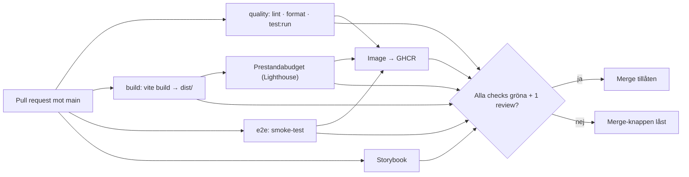
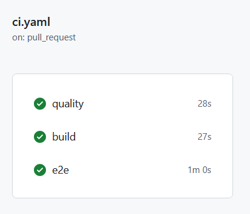
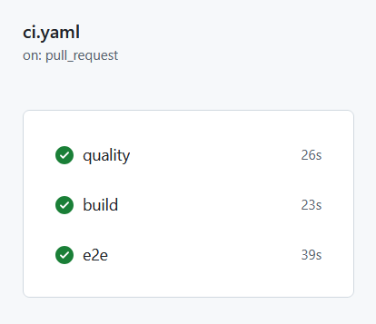
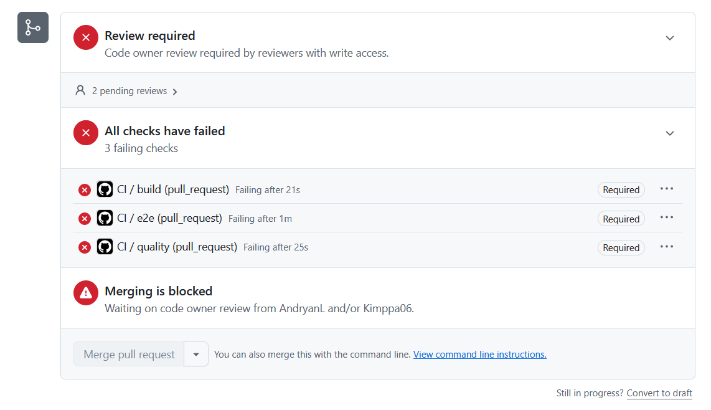

# Pipeline – Kraftly Mina sidor

## Flöde

## Beslut 1 · Jobb: parallellt eller i serie?

`quality`, `build`, `e2e` och `Storybook` körs parallellt för snabb återkoppling. `Prestandabudget (Lighthouse)` väntar på `build`-artefakten, och `Image → GHCR` körs först när testerna är gröna.

## Beslut 2 · Vad krävs för merge?

- Required status checks: `quality`, `build`, `e2e`, `Storybook`, `Prestandabudget (Lighthouse)` och `Image → GHCR`
- Minst 1 godkänd review (inklusive CODEOWNERS)
- Branchen måste vara up-to-date med `main`
- Ingen bypass (gäller även tech lead)

## Beslut 3 · Protokoll vid röd main

Den som mergade åtgärdar felet direkt. Tar fixen mer än 15 minuter revertas PR:en eller rullas tillbaka via `rollback.yml`. Ingen ny PR mergas medan `main` är röd.

## Byggtid: före och efter npm-cache

| Steg             | Utan cache | Med cache |
| ---------------- | ---------- | --------- |
| npm ci (quality) | 28 s       | 26 s      |
| npm ci (build)   | 27 s       | 23 s      |
| Hela körningen   | 60 s       | 39 s      |

Skärmdumpar:

## Skärmdump: låst merge-knapp

