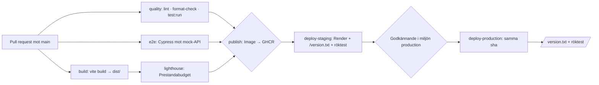
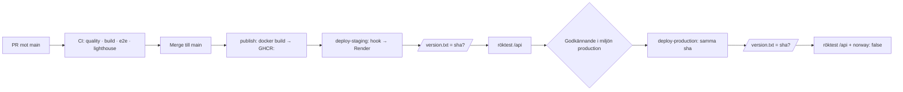

# Arbetsuppdelning per branch (M0–M7)

Den här filen är en **arbetsorder**, inte en översikt. Den beskriver exakt vilka filer som ska ändras, vilken text som ska in, och hur arbetet verifieras – så att en mindre modell (eller en trött människa) kan utföra en branch i taget utan att gissa.

Källan till varje krav är `docs/M_instruktioner/M0.md`–`M7.md` samt `docs/M_instruktioner/checklista_slutinlamning.md`. **M8–M10 ingår inte** i den här filen (M8 hanteras separat).

---

## Så här används filen

### Regler för den som skriver

1. **En branch i taget.** Skapa branchen från färskt `main`, gör alla punkter i avsnittet, kör verifieringen, öppna PR. Merga inte in nästa branch i samma PR.
2. **Hitta inte på serverutskrifter, tider, PR-nummer eller Actions-länkar.** Där det står `FYLL I` ska värdet hämtas på angivet ställe. Om det inte går att hämta: skriv `saknas – <orsak>` i dokumentet i stället för en påhittad siffra.
3. **Ändra bara det som står i avsnittet.** Ingen "passande" omskrivning av andra avsnitt, ingen omformatering av hela filer, inga nya beroenden.
4. **All text på svenska**, samma ton som `docs/` redan har. Kod, kommandon, filnamn och variabelnamn är på engelska.
5. **Rör inte** `missing.md`, `docs/M_instruktioner/`, `dist/`, `mock-api/node_modules/` eller `package-lock.json` (utom när avsnittet uttryckligen säger det).
6. **Bocka av varje punkt i PR-beskrivningen** (kopiera checklistan från avsnittet). `missing.md` checkas inte av.

### Verifiering – körs i varje branch innan PR

```bash
npm ci
npm run lint
npm run format:check
npm run test:run
```

Alla fyra ska vara gröna. Om `format:check` fallerar: kör `npm run format` **lokalt**, committa resultatet, kör om `format:check`. Committa aldrig ett `npm run format`-steg in i CI (se Branch 2).

Vid dokumentationsbrancher (3–6, 8) räcker det att `npm run format:check` är grönt – men kör gärna hela sviten.

### Ordning mellan brancher

| Ordning | Branch                                     | Varför                                                                                     |
| ------- | ------------------------------------------ | ------------------------------------------------------------------------------------------ |
| 1       | `chore/rensa-repo-och-readme`              | Tar bort skräp, rättar README, lägger rätt PR-mall. Allt annat vilar på den.               |
| 2       | `ci/fixa-pipeline-buggar`                  | Gör CI ärlig (format-steget) och röktesten gröna. Måste in innan M4/M5-bevisen kan stämma. |
| 3       | `docs/samla-dagboksloggar`                 | Krävs av M0–M4 och M6.                                                                     |
| 4       | `docs/komplettera-milestones`              | Kräver bevis från branch 2 och loggarna från branch 3.                                     |
| 5       | `docs/komplettera-testing-och-pipeline`    | Oberoende av 3–4, men M1/M2 kräver den.                                                    |
| 6       | `docs/komplettera-containers-och-deploy`   | Oberoende.                                                                                 |
| 7       | `fix/utloggning-och-sakerhetsdok`          | Rör `src/` – kräver branch 2 för grön CI.                                                  |
| 8       | `docs/komplettera-prestanda-och-rendering` | Sist, ren dokumentation.                                                                   |

---

## Läget i repot just nu (fakta att utgå från)

- `HEAD` på `main` = `c664dcf`, taggad **M7**, i synk med `origin/main`. Ingen `git pull` behövs.
- **Ocommittade ändringar i arbetskatalogen** (redan utförda, ska committas i Branch 1):
  - borttagna: `tat`, `curl`, `cache-before.txt`, `docs/decisions/debt.md`, `docs/decisions/e2e.md`
  - nya: `docs/debt.md`, `docs/decisions/e2e-verktyg.md`, `.github/PULL_REQUEST_TEMPLATE.md` (versaler)
  - otrackade men **ska inte committas**: `missing.md`, `docs/M_instruktioner/`
- `docs/log.md` finns **inte**. Loggarna ligger utspridda i `docs/daily_logs/`.
- `.github/workflows/ci.yaml` (inte `.yml`), badge i README pekar på `ci.yaml`.
- `quality`-jobbet kör `npm run format` **före** `format:check` – det gör att `format:check` aldrig kan fälla en PR.
- `deploy-staging` och `deploy-production` röktestar `POST /api/login` (v1) med `{"email":"a@b.se","password":"x"}`. API v2 svarar **401** på det kontot, och `curl -fsS` gör då hela deploy-jobbet rött.
- `docs/testing.md`, `docs/pipeline.md`, `docs/decisions/deploy.md`, `docs/security.md`, `docs/performance.md` innehåller fortfarande malltext (`…`, `<...>`, "Kikar på det senare").
- `docs/milestones.md` saknar `## M1`, `## M3`, `## M4`, `## M6`, `## M7` och har `- [ x ]` (felaktig checkbox-syntax) under `## M2`.

---

## Försteg (görs innan branch 1 skapas)

- [ ] **Stoppa in `missing.md` och kursmaterialet i lokal exkludering** så att de inte följer med av misstag:
  ```bash
  printf '\n# Lokal planering – committas inte\nmissing.md\ndocs/M_instruktioner/\n' >> .git/info/exclude
  ```
  (Använd `.git/info/exclude`, inte `.gitignore` – filerna ska inte synas i repot.)
- [ ] **Spara `cache-before.txt`-innehållet** innan branchen skapas. Filen är redan borttagen ur arbetskatalogen men finns i git:
  ```bash
  git show HEAD:cache-before.txt
  ```
  Innehållet är två `HTTP/1.1 200 OK`-svar med `Content-Type: text/plain` och `etag`/`last-modified`. Det räcker **inte** som M5-bevis (M5 kräver fyra URLs, före och efter). Behandla det som en ledtråd och kör om mätningen enligt Branch 3.
- [ ] **Verifiera att inget är stashat av misstag:**
  ```bash
  git status --short
  ```
  Förväntat: enbart de borttagna/nya filerna ovan, plus `?? missing.md` och `?? docs/M_instruktioner/`.

---

## Branch 1: `chore/rensa-repo-och-readme`

**Milstolpar:** M0, M1, M3, M4
**Filer:** `tat`, `curl`, `cache-before.txt`, `docs/decisions/debt.md`, `docs/decisions/e2e.md` (bort), `docs/debt.md`, `.github/PULL_REQUEST_TEMPLATE.md` → `.github/pull_request_template.md`, `docs/decisions/e2e-verktyg.md`, `README.md`

### 1.1 Ta bort skräpfilerna i repo-roten [M0]

Filerna är redan borttagna i arbetskatalogen. Kontrollera och committa borttagningen:

```bash
git status --short        # ska visa: D cache-before.txt, D curl, D tat
git add -A -- cache-before.txt curl tat
```

- `tat` = utskrift av `git branch` som committats av misstag.
- `curl` = tom 0-bytesfil.
- `cache-before.txt` = rå HTTP-utskrift som hör hemma i `docs/milestones.md` (M5), inte i roten.

### 1.2 Flytta skuldinventeringen till `docs/debt.md` [M0, M1, M6, M7]

Redan gjord (`docs/decisions/debt.md` → `docs/debt.md`). Committa flytten så att git ser den som en rename:

```bash
git add -A -- docs/decisions/debt.md docs/debt.md
```

**Komplettera sedan `docs/debt.md`.** Filen ska vara en numrerad lista som går att referera till från tester och DoD. Lägg till en inledande rad:

```md
Skuldinventering för Kraftly Mina sidor. Numren används i testkommentarer och i docs/milestones.md – ändra inte numreringen, lägg nya poster sist.
```

Behåll nummer 1–14 oförändrade. Lägg till följande poster **efter** nummer 14:

```md
15. Fält utan kopplad `<label for>` – inloggning och profil har bara placeholder, profilen har ingenting. Skärmläsare och `getByLabelText` hittar dem inte. (Betalas i M8.)
16. `*:focus { outline: none; }` i `src/assets/styles.css` – tangentbordsanvändare ser inte var fokus är. (Samma skuld som 9, betalas i M8.)
17. `<html lang="en">` och `<title>Vite App</title>` i `index.html` – fel språk och ingen sidtitel. (Betalas i M8.)
18. Fakturatabellen i `InvoicesView.vue` saknar `<thead>`, `scope="col"` och text i den tomma rubriken; "Ladda ner" är en `<div @click>`. (Betalas i M8.)
19. Inloggningen saknar riktig utloggning: `logout()` i `App.vue` nollställer bara access-token i minnet, refresh-cookien ligger kvar och en omladdning loggar in användaren igen. (Betalas i M6.)
```

Lägg också till en mappningstabell **sist** i filen, så att kursens skuldnummer går att slå upp:

```md
## Mappning mot kursens skuldnummer

| Kursens referens                  | Poster här           |
| --------------------------------- | -------------------- |
| M1 – regressionstest på en bugg   | 1, 2, 14             |
| M4 – API-nyckeln i `api.js`       | 5                    |
| M6 – fejkad inloggning            | 1, 2, 12, 19         |
| M7 – bundle och hero-bild         | 4, 6, 14             |
| M8 – knappar, fält, fokus, tabell | 3, 9, 15, 16, 17, 18 |
```

### 1.3 Skapa default-PR-mallen med gemener [M0]

GitHub letar efter `.github/pull_request_template.md` (gemener). Den ocommittade filen heter `PULL_REQUEST_TEMPLATE.md` (versaler) och innehåller bara en HTML-kommentar.

```bash
git mv .github/PULL_REQUEST_TEMPLATE.md .github/pull_request_template.md
# om filen inte är tillagd i git än: flytta med `mv` och `git add` den nya sökvägen
```

Skriv exakt detta innehåll:

```md
## Vad ändrades?

<!-- Kort beskrivning av ändringen och varför den behövs. -->

## Vilken milstolpe eller skuld?

<!-- t.ex. M3, eller "skuld 5 i docs/debt.md". -->

## Hur testar man?

<!-- Steg för steg så att granskaren kan verifiera själv. -->

## Checklista

- [ ] `npm run lint` grönt
- [ ] `npm run format:check` grönt
- [ ] `npm run test:run` grönt
- [ ] Ny logik har ett nytt test
- [ ] Buggfix har ett regressionstest som namnger skulden i `docs/debt.md`
- [ ] CI grönt (quality, build, e2e, lighthouse)
- [ ] Minst en annan person har granskat och godkänt
- [ ] Commit-meddelandet följer conventional commits
- [ ] Grenen utgår från färskt `main`
```

Behåll de tre specialmallarna i `.github/PULL_REQUEST_TEMPLATE/` – de används via `?template=`. Ta inte bort dem.

### 1.4 Byt namn på och komplettera E2E-beslutet [M1]

Redan gjord flytt (`docs/decisions/e2e.md` → `docs/decisions/e2e-verktyg.md`).

M1 kräver att `## Alternativ vi jämförde` täcker sex punkter: _tid till första gröna test · hur man hittar element · mockning · väntan/flakiness · headless i CI · felmeddelanden_. Ersätt dagens enda mening (rad 12) med en tabell. **Fyll bara i det teamet faktiskt observerat** – står det inget i loggen, skriv `inte undersökt i workshopen` i stället för att hitta på.

```md
## Alternativ vi jämförde

Cypress och Playwright, utifrån det vi själva såg i Boiler Room 1.

| Punkt                      | Cypress                                | Playwright                  |
| -------------------------- | -------------------------------------- | --------------------------- |
| Tid till första gröna test | 21 ms (uppmätt)                        | inte undersökt i workshopen |
| Hur man hittar element     | `cy.get()` / `cy.contains()`           | inte undersökt i workshopen |
| Mockning                   | inte undersökt i workshopen            | inte undersökt i workshopen |
| Väntan / flakiness         | inte undersökt i workshopen            | inte undersökt i workshopen |
| Headless i CI              | `cypress run` (körs i vårt `e2e`-jobb) | inte undersökt i workshopen |
| Felmeddelanden             | inte undersökt i workshopen            | inte undersökt i workshopen |
```

Behåll `## Motivering` som den är. Ersätt `## Konsekvenser` (rad 18–19) med text som svarar på **vad vi ger upp** och **vad som krävs för att byta senare**:

```md
## Konsekvenser

Vi ger upp Playwrights inbyggda stöd för flera webbläsare och dess trace viewer; vi kör bara Chromium via Cypress. Vi ger också upp möjligheten att köra `npx playwright install --with-deps` som en färdig CI-rad.

Att byta senare kräver: att det här dokumentet skrivs om, att `cypress/`-testerna portas till `e2e/*.spec.js`, att `package.json`-skriptet `e2e:cy` ersätts med `e2e:pw`, att `include: ['src/**/*.test.js']` finns i `test`-blocket i `vite.config.js` (annars försöker Vitest köra E2E-filerna), samt att `e2e`-jobbet i `.github/workflows/ci.yml` byter steg. Kostnaden är några timmar, inte ett arkitekturbeslut.
```

### 1.5 Rätta `README.md` [M0, M3, M4, M5]

Radnumren gäller dagens fil.

1. **`## Getting started` (rad 7):** lägg `cp .env.example .env` som allra första steg, före `### Lokalt Med Docker`. Både Docker-vägen och `npm run api` kräver `.env`. README kräver det idag först under `### Staging`, vilket är fel – staging kräver ingen lokal `.env`.

````md
## Getting started

Kopiera först miljöfilen – utan den startar varken mock-API:t eller compose:

```bash
cp .env.example .env
```

### Lokalt Med Docker
````

2. **`### Staging` (rad 20–30):** ta bort `cp .env.example .env`-stycket (det flyttas upp) och lägg till meningen om kallstart:

```md
### Staging

Gå in på https://kraftly-ohm-staging.onrender.com för att komma åt stagingmiljön.

Instansen ligger på Renders gratisnivå och sover efter 15 minuters inaktivitet – första anropet kan ta upp mot en minut.
```

3. **`### Produciton` (rad 32):** rätta stavfelet till `### Produktion` och lägg till samma kallstart-mening som staging.

4. **`## Projektstruktur` (rad 57–59):** rätta filnamnen och komplettera:

```md
- `src/` – Vue.js-frontend
- `mock-api/` – Mock-API för lokal utveckling
- `nginx.conf.template` – Nginx-mall; `PORT`, `API_URL` och `API_KEY` fylls i vid containerstart
- `Dockerfile` – Multi-stage build (Node → nginx)
- `compose.yml` – Lokal utvecklingsmiljö (frontend + mock-API)
- `docs/` – milstolpar, beslut och mätvärden
- `docs/decisions/` – ett beslutsdokument per tekniskt beslut
```

5. **`## Pull Requests` (rad 67–69):** M0 kräver en _definition of done för PR:er_ i working agreement, inte bara "minst en granskar". Ersätt avsnittet:

```md
## Pull Requests

Minst en annan person måste granska och godkänna innan merge till `main`. Vi använder mallen i `.github/pull_request_template.md`.

En PR är klar att merga när:

- `quality` (lint, format-check, test:run), `build`, `e2e` och `Prestandabudget (Lighthouse)` är gröna i CI
- ny logik har ett nytt test, och en buggfix har ett regressionstest som namnger skulden i `docs/debt.md`
- minst en annan person har godkänt, och grenen är uppdaterad mot `main`
- PR-beskrivningen säger vad som ändrades, varför, och hur man testar det
```

6. **`## Tech Lead` (rad 75–79):** rotationen sker enligt M2 **var tredje eller var fjärde vecka**. Förtydliga:

```md
## Tech Lead

Rotationen sker var tredje eller var fjärde vecka beroende på teamets storlek. Avgående tech lead lämnar en kort överlämning i `docs/log.md` (vad som är igång, vad som skaver, vilket beslut som närmast behöver omprövas).

Vecka 1–4: Veronica
Vecka 5–8: Kim
Vecka 9–12: Andryan
```

### 1.6 Klart när

- [ ] `git status` i branchen visar inga spår av `tat`, `curl`, `cache-before.txt`
- [ ] `docs/debt.md` finns med poster 1–19 och mappningstabellen
- [ ] `.github/pull_request_template.md` finns med gemener och innehåller checklistan
- [ ] `docs/decisions/e2e-verktyg.md` har sex jämförelsepunkter och ett `## Konsekvenser` som säger vad som ges upp
- [ ] `README.md` börjar Getting started med `cp .env.example .env`, har `### Produktion`, rätt filnamn i Projektstruktur, PR-DoD och tech lead-rotation
- [ ] `npm run format:check` grönt
- [ ] PR öppnad och godkänd av någon annan

---

## Branch 2: `ci/fixa-pipeline-buggar`

**Milstolpar:** M2, M4, M5, M7
**Filer:** `.github/workflows/ci.yaml` → `.github/workflows/ci.yml`, `README.md` (rad 1), GitHub-inställningar (ruleset)

### 2.1 Byt namn på workflowfilen till `ci.yml` [M2]

M2 DoD säger uttryckligen `.github/workflows/ci.yml`.

```bash
git mv .github/workflows/ci.yaml .github/workflows/ci.yml
```

Uppdatera badge-länken på rad 1 i `README.md` (båda förekomsterna av `ci.yaml`):

```md
[](https://github.com/vbystroem/Team-Ohm_Kraftly-Mina-Sidor/actions/workflows/ci.yml)
```

### 2.2 Ta bort `npm run format` ur `quality` [M2]

På rad 34–35 körs `- name: Run Prettier format` (`prettier --write .`) precis före `format:check`. Det skriver över formateringsfel i runnern, så `format:check` aldrig kan fälla en PR.

Ta bort hela steget:

```yaml
- name: Run Prettier format
  run: npm run format
```

Kvar ska `Run linter (ESLint)` → `Run Prettier check` → `Run tests` ligga.

### 2.3 Lägg till minsta möjliga rättigheter högst upp [M2]

M2:s recept har `permissions: contents: read` på toppnivå – det är en av de två raderna som är "värda att förstå". Lägg in efter `on:`-blocket och före `concurrency:`:

```yaml
permissions:
  contents: read
```

`publish`-jobbet har redan sitt eget `permissions` med `packages: write`; det ska ligga kvar och skriver över toppnivån för det jobbet.

### 2.4 Använd Node 22 i alla jobb [M2]

`quality`, `build` och `e2e` kör `node-version: '24'`/`24`, medan `lighthouse`, `Dockerfile` (`node:22-alpine`) och kursens recept använder 22. Ändra till `22` i alla jobb så att CI och imagen bygger på samma version.

```yaml
with:
  node-version: 22
  cache: npm
```

### 2.5 Ta bort det trasiga steget i `deploy-staging` [M4]

Rad 171–172:

```yaml
- name: Show image size
  run: docker image ls kraftly-frontend
```

`deploy-staging` körs på en ren runner där ingen image heter `kraftly-frontend` – steget kan bara ge brus. Ta bort det. Imagestorleken loggas redan i `publish` (`docker image ls "$IMAGE" --format ...`), vilket är M3/M4-kravet.

### 2.6 Uppdatera röktesten till API v2 [M4, M5, M6]

Två ställen: `deploy-staging` (rad 163–170) och `deploy-production` (rad 226–239).

Dagens anrop är `POST "$URL/api/login"` med `{"email":"a@b.se","password":"x"}`. Två fel:

1. `/api/login` är v1 och avvecklas 13/10.
2. Testkontot `a@b.se` finns inte i v2. V2 svarar **401**, och eftersom `curl -fsS` får ett felaktigt svar blir hela deploy-jobbet rött.

Byt till v2 med testkontot från Canvas "Testkonton v.7" (`anna.andersson@example.com` / `kraftly-anna`):

```yaml
- name: Röktest – går inloggningen genom proxyn?
  env:
    URL: ${{ vars.STAGING_URL }}
  run: |
    URL="${URL%/}"
    curl -fsS -X POST "$URL/api/v2/auth/login" \
      -H 'Content-Type: application/json' \
      -d '{"email":"anna.andersson@example.com","password":"kraftly-anna"}'
    echo
    echo "✅ /api/v2 svarar via nginx med nyckeln från Render"
```

Gör motsvarande i `deploy-production`, men behåll kontrollen av Norge-flaggan efter inloggningen:

```yaml
- name: Röktest – svarar produktion utan Norge-kortet?
  if: steps.hook.outputs.deployed == 'true'
  env:
    URL: ${{ vars.PROD_URL }}
  run: |
    URL="${URL%/}"
    curl -fsS -X POST "$URL/api/v2/auth/login" \
      -H 'Content-Type: application/json' \
      -d '{"email":"anna.andersson@example.com","password":"kraftly-anna"}'
    echo
    if curl -fsS "$URL/config.js" | grep -q "norway: false"; then
      echo "✅ /api svarar och FEATURE_NORWAY är av i produktion"
    else
      echo "::error::Norge-flaggan är PÅ i produktion – kontrollera FEATURE_NORWAY i Render"
      exit 1
    fi
```

> **Varför inte `-H "X-Api-Key: ..."`?** Anropet går via nginx-proxyn, som redan lägger på nyckeln från miljön. Lägger ni på en egen nyckel i CI läcker den dessutom in i loggen i onödan.

### 2.7 Kontrollera regler utanför repot (kan inte göras i kod) [M4]

Efter att `image`-jobbet ersatts av `publish` i M4 måste required status check bytas, annars blockeras varje PR av en check som aldrig rapporteras:

- [ ] GitHub → Settings → Rules → Rulesets → regeln för `main` → required status checks innehåller `quality`, `build`, `e2e`, `Prestandabudget (Lighthouse)`, **`Image → GHCR`** (inte `image`) och inte något jobb som tagits bort.
- [ ] Bypass-listan är tom.
- [ ] `Require branches to be up to date` är på.

Skriv i PR-beskrivningen vilka checks som ligger där efter ändringen.

### 2.8 Klart när

- [ ] `.github/workflows/ci.yml` finns, `ci.yaml` är borta
- [ ] README-badgen pekar på `ci.yml`
- [ ] `quality` innehåller inget `npm run format`-steg
- [ ] `permissions: contents: read` finns på toppnivå
- [ ] alla jobb använder Node 22
- [ ] `Show image size` är borta ur `deploy-staging`
- [ ] båda röktesten anropar `/api/v2/auth/login` med testkontot och blir gröna på `main`
- [ ] `npm run lint && npm run format:check && npm run test:run && npm run build` grönt lokalt
- [ ] reglerna i 2.7 kontrollerade och noterade i PR:en

---

## Branch 3: `docs/komplettera-milestones`

**Milstolpar:** M1, M2, M3, M4, M5, M6, M7
**Filer:** `docs/milestones.md`

Regeln för hela branchen: **beviset ska ligga i ett kodblock eller som länk direkt under respektive DoD-punkt.** Egna filer, PR-beskrivningar eller skärmdumpar räknas inte (M5 är uttrycklig: "Bevisen ligger i egna filer eller i PR-beskrivningar → de ska stå under DoD-punkten i milestones.md, det är där jag tittar").

Struktur per milstolpe:

````md
## M1 – Kvalitetsgrund

- [x] <DoD-punkt>
  ```
  <utskrift eller länk>
  ```
````

### 3.1 Rätta checkbox-syntaxen under `## M2` [M2]

Rad 13–20 har `- [ x ]` med mellanslag, vilket GitHub inte renderar som kryssruta. Ersätt alla åtta med `- [x]`.

### 3.2 Lägg till `## M1 – Kvalitetsgrund` [M1]

Sätt in efter `## M0`-blocket. Punkterna är M1:s DoD ordagrant:

```md
## M1 – Kvalitetsgrund

- [x] Testsvit med minst 10 meningsfulla test – både logik (enhet) och komponent, körbara med `npm run test:run`, alla gröna
- [x] Minst 5 av testerna är på kod som inte var med i torsdagens övningar (stores, api.js, LoginView, ProfileView, spinnern, det svalda felet …)
- [x] Minst ett regressionstest på en bugg ur `docs/debt.md` – testet namnger skulden i testnamn eller kommentar
- [x] ESLint + Prettier körs i pre-commit via husky + lint-staged. `npm run lint` och `npm run format:check` går igenom på `main`
- [x] Teststrategi i `docs/testing.md` enligt workshopen: nivåer, karta, fem beslut (inkl. täckningskrav), vad vi medvetet inte testar
- [x] E2E-beslutet i `docs/decisions/e2e-verktyg.md`, och Cypress-smoken är mergad och körbar med `npm run e2e:cy`
- [x] Logg i `docs/log.md`: en post per arbetsdag – vad vi gjorde, vad som var svårt, vem som gjorde vad
```

Lägg bevis under punkt 1 och 2:

```bash
npm run test:run
```

Klistra in sista raden (antal testfiler/test) i ett kodblock. Under punkt 3: skriv vilken skuld som avses, t.ex.:

```md
Regressionstest: `src/utils/validateMove.test.js` – "should return invalid if address is only blank space" (skuld 1/2 i `docs/debt.md`: validering som släppte igenom tomma värden).
```

### 3.3 Lägg till `## M3 – Containeriserad` [M3]

```md
## M3 – Containeriserad

- [x] Multi-stage `Dockerfile` i repots rot: byggsteg med Node, serveringssteg med nginx. Ingen Node och ingen `node_modules` i den färdiga imagen
- [x] `.dockerignore` med minst `node_modules`, `dist` och `.git`
- [x] `nginx.conf.template` med SPA-fallback – omladdning på `/fakturor` ger appen, inte 404
- [x] Imagen är under 100 MB – `docker image ls` i `docs/containers.md`
- [x] `docker compose up --build` från ett rent klon startar frontend (`localhost:8080`) och mock-API, och man kan logga in och se dashboarden
- [x] `docker build` som eget CI-jobb, grönt på `main`, med imagens storlek i loggen
- [x] `docs/containers.md` enligt mallen: hur man kör, storlekstabell (naiv vs. multi-stage), tre beslut, vad som körs i CI, kända begränsningar
- [x] `README` Getting started omskriven: ett sätt med Docker, ett utan – och `npm start`-felet borta
- [x] Logg i `docs/log.md`: en post per arbetsdag, inklusive vem som gjorde vad. Ny tech lead presenterad
```

Bevis: `76.8 MB` från `docs/image-9.png` samt länk till den gröna `publish`-körningen. Skriv:

```md

```

$ docker image ls kraftly-mina-sidor
kraftly-mina-sidor:latest 8a50bd5d783f 76.8MB 23.5MB

```

```

### 3.4 Lägg till `## M4 – Continuous Delivery` [M4]

```md
## M4 – Continuous Delivery

- [x] Nyckeln ut ur koden: ingen API-nyckel i `src/` och inga hemligheter i `VITE_`-variabler. Appen anropar `/api` relativt, och nginx lägger på `X-Api-Key` från miljön (`nginx.conf.template`)
- [x] Den gamla nyckeln är död och bevisad: `curl` mot test-API:t med nyckeln från `api.js` ger 401, utskriften i `docs/deploy.md`. Teamets nya nyckel finns bara i Render
- [x] Lokalt fungerar som förut: `.env.example` i repot, `.env` i `.gitignore` och `.dockerignore`. Från ren klon: `cp .env.example .env` + `docker compose up --build` → inloggning fungerar
- [x] Bygg en gång: pipelinen bygger imagen en gång per commit och pushar den till GHCR taggad med commitens sha – bara från `main`, aldrig från en PR
- [x] Automatisk deploy till staging: merge till `main` deployar till Render via deploy hook. Hooken ligger som secret i GitHub-miljön `staging`, adressen som variable
- [x] Verifierad deploy: deploy-jobbet väntar tills `/version.txt` visar commitens sha och gör sedan ett röktest mot `/api` – jobbet blir rött om något av dem misslyckas
- [x] Miljökonfig via variabler: `API_URL` och `API_KEY` sätts i Render, inte i imagen. Samma image kör lokalt i compose
- [x] `docs/deploy.md` enligt mallen (flöde, miljöer, var varje variabel bor, nyckeln, rollback, uppmätta tider, kända begränsningar) + `docs/decisions/hosting.md` med minst tre jämförda alternativ
- [x] README med staging-adressen och Kom igång som börjar med `cp .env.example .env` · logg i `docs/log.md`, en post per arbetsdag, med vem som gjorde vad
```

Bevis under punkt 5–6:

````md
```
$ curl -s https://kraftly-ohm-staging.onrender.com/version.txt
<sha>
$ git rev-parse HEAD
<samma sha>
```

Actions-körning: <länk till grön deploy-staging-körning>
````

Hämta `<sha>`/länken från Actions → den senaste gröna körningen på `main` (`Deploy → staging`).

### 3.5 Ersätt `## M5 – Produktionsmiljö` med DoD-punkter och bevis [M5]

Dagens M5-block är prosa. M5 kräver **bevis under varje punkt**, särskilt fyra saker som idag saknas helt: `curl`-utskrifter för flaggan, `curl -I` före/efter för cache, länk + tid för rollbacken och prod-raden.

Använd den här strukturen:

```md
## M5 – Produktionsmiljö

- [x] Produktion skild från staging: egen Render-tjänst på egen adress, `APP_ENV=production`, ingen miljöbanner. Samma image som staging: `version.txt` visar samma sha på båda efter en deploy
- [x] Godkännande före prod: GitHub-miljön `production` har required reviewers (hela teamet) och Prevent self-review. `deploy-production` har `needs:` på staging-jobbet, deployar `ghcr.io/…:<sha>` via hook, väntar på `/version.txt` och gör ett röktest som blir rött om flaggan är på i prod
- [x] Norge-stödet bakom en feature flag: synlig förändring på översikten, styrd av `FEATURE_NORWAY` som containern läser vid start. På i staging, av i prod. Två tester: flaggan och komponenten
- [x] `docs/decisions/feature-flags.md`: minst tre alternativ (branch, byggtidsflagga, körtidsflagga), motivering och när flaggan ska bort
- [x] Cache-headers konfigurerade och verifierade: `/assets/` med `public, max-age=31536000, immutable`, `index.html`/`config.js`/`version.txt` med `no-cache`
- [x] Rollback genomförd i praktiken: `rollback.yml` med val av miljö, körd mot staging
- [x] `docs/scaling.md` enligt mallen: era mätvärden (autocannon, tre anrop, req/s + p99, kommandot), vad de säger om flaskhalsen, vad ni gjorde, varför (inte) Kubernetes, regeln för flagga kontra rollback med tider
- [x] Adresserna: prod-raden i miljötabellen i `docs/deploy.md` och prod-adressen i README
```

Bevisen – kör kommandona och klistra in **den faktiska utskriften**:

Under flaggan:

```bash
curl -s https://kraftly-ohm-staging.onrender.com/config.js
curl -s https://kraftly-ohm.onrender.com/config.js
```

Under cache (fyra filer, före och efter). Filnamnet hämtas med:

```bash
curl -s https://kraftly-ohm-staging.onrender.com/ | grep -o 'assets/index-[^"]*js'
```

Kör sedan mot staging:

```bash
curl -sI https://kraftly-ohm-staging.onrender.com/assets/<filnamn>.js | grep -i -E 'cache-control|etag'
curl -sI https://kraftly-ohm-staging.onrender.com/ | grep -i -E 'cache-control|etag'
curl -sI https://kraftly-ohm-staging.onrender.com/config.js | grep -i -E 'cache-control|etag'
curl -sI https://kraftly-ohm-staging.onrender.com/version.txt | grep -i -E 'cache-control|etag'
```

`docs/cache-before.txt` som låg i roten innehöll bara två `200 OK`-svar för `text/plain` (troligen `/version.txt`) och **räcker inte**. Om den gamla staging-imagen inte längre går att mäta: skriv `Före: ingen Cache-Control-header (mätt <datum> mot <url>)` och använd den faktiska efter-utskriften. Hitta inte på före-värden.

Under rollback: länk till Actions-körningen och den uppmätta tiden, t.ex. `26 s` från `docs/scaling.md`.

### 3.6 Lägg till `## M6 – Säkrad` [M6]

```md
## M6 – Säkrad

- [x] Riktig inloggning: `LoginView` loggar in mot `/api/v2/auth/login` med e-post och lösenord, visar felmeddelande vid fel uppgifter (`role="alert"`), och den fejkade `localStorage`-flaggan är borttagen ur hela koden
- [x] Access token i minnet, inte i `localStorage`: test eller motivering i `docs/security.md` som visar att token inte hamnar i webblagring. Refresh mot cookien; omladdning loggar inte ut
- [x] Skyddade routes + skyddat API: route guard skickar utloggade till `/login`, och `/api/v2/invoices` svarar 401 utan token (curl eller test)
- [x] Ingen kund ser en annans data: fakturor/förbrukning väljs ur token. En variant med `?customerNo=` ignoreras (A01/IDOR)
- [x] OWASP-genomgång i `docs/security.md`: en rad per relevant kategori (minst A01, A02, A05, A07) med vad vi hittade och vad vi gjorde
- [x] CORS låst: API-anropen går genom egen proxy (samma origin). Riktig CORS: uttrycklig origin-lista, aldrig `*` med cookies. Motiveringen i `docs/security.md`
- [x] CSP + säkerhetsheaders: CSP (`default-src 'self'; script-src 'self'`) plus `X-Content-Type-Options`, `X-Frame-Options`/`frame-ancestors` i nginx. `curl -I` på staging visar dem
- [x] `docs/decisions/tokenlagring.md`: var access token lagras, alternativen (localStorage/cookie/minne) och varför
- [x] Testerna gröna (minst ett nytt test på auth-flödet eller att ett skyddat anrop kräver token) · logg i `docs/log.md`
```

Bevis under punkt 2, 3 och 7 – kör och klistra in:

```bash
curl -s -o /dev/null -w "%{http_code}\n" https://kraftly-ohm-staging.onrender.com/api/v2/invoices
curl -sI https://kraftly-ohm-staging.onrender.com/ | grep -i -E 'content-security-policy|x-frame-options|x-content-type-options|referrer-policy|strict-transport-security'
```

Punkt 4 kräver ett test eller en `curl` där `?customerNo=K-999999` läggs på och svaret är **samma data** som utan parametern.

### 3.7 Lägg till `## M7 – Snabb` [M7]

```md
## M7 – Snabb

- [x] Mätmetoden står skriven: verktyg och inställningar i `docs/performance.md` (produktionsbygget, enhetsläge, nätverksstrypning, cache av, median av flera körningar) – samma för före och efter
- [x] Minst tre optimeringar med före/efter-mätning i `docs/performance.md`, varav minst en som förbättrar LCP eller CLS på dashboarden och minst en som minskar mängden JavaScript. Varje optimering har en egen PR, länkad i dokumentet
- [x] Dashboarden inom gränserna: LCP under 2,5 s och CLS under 0,1 (lokalt produktionsbygge, iPhone 12 Pro, Fast 4G, cache av)
- [x] Prestandabudget i CI: `lighthouserc.json` med minst LCP, CLS och JavaScript-storlek som `error`, och jobbet `Prestandabudget (Lighthouse)` körs på varje PR
- [x] Budgeten stoppar: jobbet är en required status check på `main`, och `publish` väntar på det (`needs`). JavaScript-taket ligger strax över faktisk siffra, motiverat i dokumentet
- [x] Testerna gröna – och om vi bytt import av ett mockat bibliotek är mocken flyttad med (inga `getContext`-fel i testloggen)
- [x] `docs/decisions/rendering.md`: SPA, SSR (Nuxt) eller SSG – jämförelse, beslut och när beslutet ska omprövas
```

Bevis under punkt 4:

```md
Actions-körning: <länk till grön Prestandabudget (Lighthouse)-körning>
```

Under punkt 5: skriv att `Prestandabudget (Lighthouse)` ligger som required check och att `publish` har `needs: [quality, e2e, lighthouse]` (verifiera mot `.github/workflows/ci.yml`).

### 3.8 Klart när

- [ ] `## M1`, `## M3`, `## M4`, `## M5`, `## M6`, `## M7` finns med numrerade/avbockade DoD-punkter
- [ ] `## M2` använder `- [x]`, inte `- [ x ]`
- [ ] under varje punkt som kräver bevis finns ett kodblock eller en länk – inga `…` kvar
- [ ] inga påhittade siffror: alla `curl`-utskrifter är kopierade från en faktisk körning
- [ ] `npm run format:check` grönt
- [ ] PR godkänd av någon annan

---

## Branch 4: `docs/samla-dagboksloggar`

**Milstolpar:** M0, M1, M2, M3, M4, M6
**Filer:** `docs/log.md` (ny), `docs/daily_logs/*` (arkiv, lämnas kvar)

### 4.1 Skapa `docs/log.md`

M0–M4 och M6 kräver loggen i `docs/log.md`, kronologiskt, med datum och **vem som gjorde vad**. Idag finns bara `docs/daily_logs/`. Skapa `docs/log.md` och sammanfoga innehållet i datumordning. Lämna `docs/daily_logs/` kvar som arkiv (radera inte – då försvinner spåret).

Börja filen med:

```md
# Arbetslogg – Kraftly Mina sidor

En post per arbetsdag: vad vi gjorde, vad som var svårt och vem som gjorde vad. Nyaste posten sist. Tech lead-överlämningar skrivs som egen post vid rotation.
```

### 4.2 Transkribera de loggar som finns

Använd texten ordagrant, men rätta uppenbara mallrader. Mappning (fil → datum):

| Källa                            | Datum      | Innehåll                                                              |
| -------------------------------- | ---------- | --------------------------------------------------------------------- |
| `docs/daily_logs/log.md`         | 2026-08-28 | Boiler Room 1: tester, fyra PR:ar (#11–#14), fastnade på enhetstester |
| `docs/daily_logs/log2.md`        | 2026-09-03 | Workshop M2, parprogrammering                                         |
| `docs/daily_logs/2026_09_10.md`  | 2026-09-10 | Andryan `-`, Kim `-`, Veronica `nginx.conf`                           |
| `docs/daily_logs/2026_09_15.md`  | 2026-09-15 | Dockerfile/nginx/.dockerignore, docker build, containers.md           |
| `docs/daily_logs/2026_09_18.md`  | 2026-09-18 | spår 2 + dokumentation, Kim ny tech lead, GitHub secrets              |
| `docs/daily_logs/2026_09_21.md`  | 2026-09-21 | hostingutredning, dokumentation                                       |
| `docs/daily_logs/2026-v39-40.md` | v39–v40    | M5 parprogrammerat, Kim semester                                      |

**Rätta följande när du transkriberar:**

- 2026-08-28: raden `E2E: valde \_\_\_ · smoke + mockat test gröna: N/A` ska bli:
  `E2E: valde Cypress · smoke-test grönt lokalt: ja · komponenttest med mockat API: ja`
  (bekräfta mot `docs/decisions/e2e-verktyg.md`; skriv `nej` om det inte var grönt).
- 2026-09-10: fyll Andryan och Kim med vad de faktiskt gjorde. Underlag:
  ```bash
  git log --since=2026-09-10 --until=2026-09-11 --pretty='%h %an %s'
  ```
  Skriv en rad per person. Om underlaget inte räcker: `- deltog i workshop M3 (ingen egen commit den dagen)`. Lämna inte `-` kvar.
- Ta bort alla `[Gör egen PR med vad ni gjort under den här dagen]` – det är instruktionstext, inte logg.

### 4.3 Lägg till de poster som saknas

Alla datum nedan saknar loggpost. Skriv en post per datum enligt mallen, med underlag från git:

```bash
git log --since=<datum> --until=<datum+1> --pretty='%h %an %s'
```

```md
## <ÅÅÅÅ-MM-DD>

Gjort:

- <vad>

Svårt:

- <vad>

Vem gjorde vad:

- Andryan: …
- Kim: …
- Veronica: …
```

Datum som måste finnas (justera om git visar annat):

- **2026-08-25 – M0:** teamrepo, skyddad `main`, working agreement, skuldinventering, appen lokalt. Svårt: att få alla att köra appen lokalt.
- **2026-09-01 – M1:** testsvit ≥ 10, regressionstest, husky + lint-staged, `docs/testing.md`, E2E-beslut, taggen `M1`.
- **2026-09-08 – M2:** `ci.yml`, branch protection, cache-mätning, badge, taggen `M2`.
- **2026-09-15 – M3:** Dockerfile, compose, `containers.md`, taggen `M3`.
- **2026-09-22 – M4:** nyckeln ut, GHCR, deploy-staging, `deploy.md`, `hosting.md`, taggen `M4`.
- **2026-09-29 – M5:** prod-tjänst, godkännandegate, Norge-flagga, cache, rollback, `scaling.md`, taggen `M5`.
- **2026-10-06 – M6:** v2-auth, token i minnet, route guard, OWASP, CSP, `tokenlagring.md`, taggen `M6`.

Lägg också in **M1:s teamreflektion** (M1 kräver den): _vad vi är mest/minst nöjda med och vilket test vi skulle visa upp._

```md
### Reflektion efter M1

- Mest nöjda med: …
- Minst nöjda med: …
- Testet vi skulle visa upp: …
```

### 4.4 Tech lead-överlämning [M2, M5/M6]

M2 kräver en överlämning när rotationen sker. Lägg in en post i anslutning till 2026-09-18 (Kim tar över) och en inför nästa byte:

```md
## Tech lead-överlämning – <datum>

- Igång: …
- Skavde: …
- Beslut som närmast behöver omprövas: …
- Ny tech lead: <namn>, presenterad på avstämningen <datum>
```

### 4.5 Klart när

- [ ] `docs/log.md` finns och innehåller poster från M0 till M6 i datumordning
- [ ] alla tre personer nämns i posterna för M1–M6
- [ ] ingen `-` eller `[Gör egen PR …]` kvar
- [ ] `E2E: valde ___` är ersatt
- [ ] M1-reflektionen finns
- [ ] minst en tech lead-överlämning finns, med namn och datum
- [ ] `npm run format:check` grönt

---

## Branch 5: `docs/komplettera-testing-och-pipeline`

**Milstolpar:** M1, M2
**Filer:** `docs/testing.md`, `docs/pipeline.md`, `src/utils/validateMove.test.js` (kommentar), `src/utils/consumption.test.js` → `src/stores/consumption.test.js`, `docs/debt.md` (om skuldhänvisning saknas)

### 5.1 Skriv om `docs/testing.md` enligt workshopen [M1]

M1 kräver strukturen från M1-workshopen: **nivåer · karta · fem beslut · vad vi medvetet inte testar · kommandon**. Dagens fil har `…` i nivåerna, "Kikar på det senare" som mockstrategi och ett täckningskrav utan motivering.

Skriv om filen till detta (behåll gärna era egna noter under kartan):

````md
# Teststrategi – Kraftly Mina sidor

## Nivåer

- **Enhet (Vitest):** ren logik utan DOM – `formatCurrency`, `firstName`, `formatDate`, `validateMove`, `isEnabled` och Pinia-storens logik. Snabba, inga mockar av Vue.
- **Komponent (Vitest + Vue Testing Library / @vue/test-utils):** en vy eller komponent renderad i jsdom, med `../services/api` modulmockat. Används när markup, `v-if` eller interaktion är det som kan gå sönder (`InvoicesView`, `MoveFormView`, `NorwayNotice`).
- **E2E (Cypress):** hela användarresan mot riktig app och riktigt mock-API – inloggning, redirect för utloggad, session över omladdning. `cypress/e2e/login.cy.js`.

## Karta: vad testas var

| Del av portalen                | Nivå      | Varför?                                                             | Finns test?                                                      |
| ------------------------------ | --------- | ------------------------------------------------------------------- | ---------------------------------------------------------------- |
| Prisformatering                | Enhet     | ren funktion, inget DOM                                             | Ja (`src/utils/format.test.js`)                                  |
| Förnamn i hälsning             | Enhet     | ren funktion                                                        | Ja (`src/utils/user.test.js`)                                    |
| Datumformatering               | Enhet     | ren funktion med kantfall (`null`, skräp)                           | Ja (`src/utils/date.test.js`)                                    |
| Fakturastatus                  | —         | logiken sitter i mallen i `InvoicesView.vue`; testas inte isolerat  | Nej (medvetet, se not)                                           |
| Validering av flyttanmälan     | Enhet     | ren funktion, inget DOM                                             | Ja (`src/utils/validateMove.test.js`)                            |
| StatusChip                     | —         | komponenten finns inte; status renderas inline i `InvoicesView.vue` | Nej (medvetet)                                                   |
| Flyttanmälans formulär         | Komponent | markup + att tomt formulär inte skickas                             | Ja (`src/views/MoveFormView.test.js`)                            |
| Fakturavyns felhantering       | Komponent | `role="alert"` vid API-fel                                          | Ja (`src/views/InvoicesView.test.js`)                            |
| Förbrukningsdiagrammet         | —         | Chart.js renderar i canvas; jsdom ritar inget. Testas inte          | Nej (medvetet, se not)                                           |
| Stores (`user`, `consumption`) | Enhet     | tillstånd och `load()`                                              | Ja (`src/stores/user.test.js`, `src/stores/consumption.test.js`) |
| API-klienten (`api.js`)        | Enhet     | `fetch`-anrop, headers, 401-refresh                                 | Ja (`src/services/api.test.js`)                                  |
| Feature flag (`isEnabled`)     | Enhet     | en flagga som inte finns ska vara av                                | Ja (`src/utils/features.test.js`)                                |
| Norge-kortet                   | Komponent | `v-if` styrd av flaggan                                             | Ja (`src/components/NorwayNotice.test.js`)                       |
| Inloggningsflödet              | E2E       | hel användarresa över flera sidor                                   | Ja (`cypress/e2e/login.cy.js`)                                   |
| Navigation / route guard       | E2E       | flera sidor och redirect                                            | Delvis (täcks av `login.cy.js`)                                  |

### Noter till kartan

- **Fakturastatus** testas inte isolerat: logiken är en ternär operator i mallen. Om den flyttas till en `StatusChip`-komponent ska den ha ett komponenttest och raden flyttas till Komponent.
- **Diagrammet** testas inte: Chart.js äger renderingen, och vi testar inte externa bibliotek. Det vi äger är datan som skickas in, och den kommer från `consumption`-storen (testad).
- **API-klienten** har ett regressionstest för 401 utan token (skuld 1/2 i `docs/debt.md`).

## Regler

### Vad vi testar och inte

Vi testar **vår** logik, vår markup och våra flöden. Vi testar inte Vue, Chart.js, CSS-klassnamn eller routerns interna beteende.

### Hur vi mockar API:et

En regel: **`vi.mock('../services/api')` i komponent- och storetester** (eller `global.fetch = vi.fn()` när själva klienten testas), och **riktigt mock-API i E2E**. Inga nätverksanrop från enhetstester.

### Vad krävs för att en PR ska mergas?

- Alla checks gröna: `quality`, `build`, `e2e` och `Prestandabudget (Lighthouse)`.
- Ny logik har ett nytt test.
- **En buggfix har ett regressionstest** som hade fångat buggen, och testet namnger skulden i `docs/debt.md` i testnamnet eller en kommentar.
- Minst en annan person har godkänt.

### Täckningskrav

**Nej, vi har inget procentmål.** Ett coverage-krav på 80 % mäter vilka rader som _kördes_, inte om något _kontrollerades_ – det går att nå 100 % med tester utan en enda `expect`. Vi lägger i stället kraften på de delar där ett fel kostar kunden pengar eller data: validering, API-klienten, auth-flödet och formulären. Om vi senare inför ett krav ska det motiveras med en siffra vi faktiskt mäter i CI (`vitest run --coverage`), inte med en reflex.

### Namngivning och placering

- Testfilen ligger **bredvid koden** och heter `<Fil>.test.js` (`src/utils/format.test.js`).
- `describe`/`it` skrivs **på svenska** när testet är nytt, eftersom testnamnet läses av människor i CI-loggen. Äldre tester med engelska namn byts inte ut bara för namnets skull.
- E2E-filer ligger i `cypress/e2e/` och heter `*.cy.js`.

## Vad vi medvetet inte testar

- Chart.js rendering och canvas (`getContext` finns inte i jsdom).
- CSS-klassnamn och exakta färger – de ändras i designarbetet.
- Vue:s och routerns interna beteende.
- Externa paket (vue, pinia, chart.js).
- Kallstart och Render-plattformen – det äger vi inte.

## Kommandon

```bash
npm test          # watch-läge, används lokalt
npm run test:run  # engångskörning, samma som CI
npm run e2e:cy    # startar mock-API + dev-server och kör Cypress
```
````

### 5.2 Flytta konsumtionstestet bredvid koden [M1]

Regeln "testfilen ligger bredvid koden" stämmer inte idag: `src/utils/consumption.test.js` testar `src/stores/consumption.js` men ligger i `utils/`.

```bash
git mv src/utils/consumption.test.js src/stores/consumption.test.js
```

Uppdatera importen i filen: `import { useConsumptionStore } from '../stores/consumption'` → `'./consumption'`. Importen av `../services/api` är fortfarande korrekt från `src/stores/`. Kör `npm run test:run` och kontrollera att antalet test är oförändrat.

### 5.3 Låt regressionstestet namnge skulden [M1]

M1 DoD punkt 3 kräver att regressionstestet säger **vilken skuld i `docs/debt.md`** det gäller. `src/utils/validateMove.test.js` har en bra kommentar men ingen skuldreferens. Lägg till en kommentar **över** testet (rad 27–29 idag):

```js
// Regressionstest för skuld 1 och 2 i docs/debt.md: valideringen släppte igenom
// en adress som bara bestod av blanksteg, så en flyttanmälan kunde skickas utan
// riktig adress. Testet fångar buggen om den kommer tillbaka.
```

Komplettera `src/services/api.test.js` på samma sätt över 401-testet:

```js
// Regressionstest för skuld 1 och 2 i docs/debt.md: innan v2-auth kunde en
// skyddad endpoint anropas utan token. Nu ska den ge 401 och kastas vidare.
```

Lägg även till en kort rad i `docs/debt.md` under post 1 eller 2: `Regressionstest: src/utils/validateMove.test.js och src/services/api.test.js.`

### 5.4 Skriv om `docs/pipeline.md` [M2]

Dagens fil har tre tomma beslutsavsnitt, en tom byggtidstabell och ett diagram som beskriver en äldre pipeline (den saknar `lighthouse`, `publish`, `deploy-staging`, `deploy-production`).

Ersätt hela filen med:

````md
# Pipeline – Kraftly Mina sidor

## Flöde



`quality`, `build` och `e2e` kör parallellt. `lighthouse` väntar på `build` eftersom den mäter artefakten. `publish` väntar på `quality`, `e2e` och `lighthouse` – ingen image utan grön kod. `deploy-staging` och `deploy-production` är i serie, och produktion kräver ett godkännande från någon annan än den som mergade.

## Beslut 1 · Jobb: parallellt eller i serie?

`quality`, `build` och `e2e` kör parallellt: snabbast svar på en PR, och inget av jobben behöver ett annat. `lighthouse` kör i serie efter `build` eftersom den mäter `dist/`. `publish` och deploy-jobben är i serie – en image ska bara byggas och pushas en gång, och staging ska verifieras innan produktion.

Kostnad: `e2e` tar cirka 40–60 sekunder och körs även på PR:ar som ändå har lintfel. Vinsten är att en trasig inloggning syns direkt i stället för efter merge. Vi väljer svarstid före några sparade CI-minuter.

## Beslut 2 · Vad krävs för merge?

- Required status checks: `quality`, `build`, `e2e` och `Prestandabudget (Lighthouse)`.
- Minst **1 approval**, och grenen måste vara uppdaterad mot `main`.
- Bypass-listan är **tom** – tech lead ingår i regeln.
- Miljön `production` har dessutom required reviewers (hela teamet) och **Prevent self-review**.

## Beslut 3 · Protokoll vid röd main

1. Den som ser att `main` är röd skriver i Discord direkt – inte efter nästa möte.
2. Tech lead bedömer inom 15 minuter: **fix framåt** om felet är litet och orsaken uppenbar (felstavning, glömd import), annars **revert** av den merge-commit som gjorde `main` röd.
3. Revert görs via PR, aldrig med `--force` och aldrig genom att hoppa över required checks.
4. Gränsen: kan felet inte vara åtgärdat inom 30 minuter revertar vi. En röd `main` är dyrare än en återställd feature.
5. Efteråt: en rad i `docs/log.md` om vad som hände och vad vi ändrar så att det inte händer igen.

## Byggtid: före och efter npm-cache

| Steg                                   | Utan cache            | Med cache          |
| -------------------------------------- | --------------------- | ------------------ |
| npm ci (quality)                       | 17 s                  | FYLL I             |
| npm ci (build)                         | 17 s                  | FYLL I             |
| Hela körningen (quality + build + e2e) | 28 s + 27 s + 1 m 0 s | 26 s + 23 s + 39 s |

Siffrorna för jobben är lästa ur skärmdumparna `docs/image-6.png` och `docs/image-7.png` (jobbtider) samt `docs/image-3.png`–`docs/image-5.png` (stegtider). **`FYLL I` för `npm ci` med cache** hämtas ur Actions-körningen där cachen var fylld – öppna körningen, Steg `npm ci`, läs tiden. Går körningen inte att öppna: mät om enligt receptet (kommentera bort `cache: npm`, kör, sätt tillbaka, kör två gånger) och skriv de faktiska siffrorna. Skriv inte "snabbare" eller en gissning.

Skärmdumpar:


## Skärmdump: låst merge-knapp


Röd PR som visar grinden: FYLL I – länk till PR:en i GitHub. Sök den i PR-historiken (PR:en innehöll commits med meddelandet "fulcommit 2: the sequel" och "fixade fulcommit"):

```bash
git log --all --oneline --grep='fulcommit'
gh pr list --state all --search 'fulcommit'   # om gh är installerat
```

Klistra in URL:en. Om PR:en inte går att hitta: skriv `saknas – PR:en finns inte kvar i historiken` och länka i stället den senaste PR:en där en required check var röd.
````

### 5.5 Klart när

- [ ] `docs/testing.md` har nivåer, komplett karta, fem beslut, "vad vi medvetet inte testar" och kommandon
- [ ] `Flyttformulär` står som `Ja` i kartan (testet finns)
- [ ] mockregeln är en regel, inte "kikar på det senare"
- [ ] täckningskravet är antingen motiverat eller borttaget med motivering
- [ ] `src/stores/consumption.test.js` ligger bredvid `consumption.js`
- [ ] regressionstesterna namnger skulden, och `docs/debt.md` pekar tillbaka
- [ ] `docs/pipeline.md` har ett diagram som matchar `.github/workflows/ci.yml`, tre ifyllda beslut, ifylld byggtidstabell och en PR-länk
- [ ] inga `…` eller `<...>` kvar (utom dokumenterade `FYLL I`)
- [ ] `npm run test:run` grönt och `npm run format:check` grönt

---

## Branch 6: `docs/komplettera-containers-och-deploy`

**Milstolpar:** M3, M4, M5
**Filer:** `docs/decisions/containers.md` → `docs/containers.md`, `docs/decisions/deploy.md` → `docs/deploy.md`, `docs/decisions/hosting.md`

### 6.1 Flytta `containers.md` till `docs/containers.md` [M3]

```bash
git mv docs/decisions/containers.md docs/containers.md
```

M3 kräver `docs/containers.md`; beslutsdokumenten i `docs/decisions/` är en annan sak. Rätta sedan:

1. **Rad 17–18 och 25:** `nginx:1.24-alpine` → `nginx:1.27-alpine` (det `Dockerfile` faktiskt använder).
2. **Rad 10–11:** API:et nås via nginx-proxyn på `http://localhost:8080/api` när man kör `compose.yml` – port `4000` är bara publicerad internt mellan containrarna:

```md
- Frontend: http://localhost:8080
- API: http://localhost:8080/api (nginx proxar vidare till `api:4000`; port 4000 är inte publicerad)
```

3. **Lägg till under `## Kända begränsningar`:**

```md
- Imagen byggs för den arkitektur maskinen har. Apple Silicon bygger `linux/arm64`, medan GitHub Actions och Render kör `linux/amd64` – därför är det bara pipelinen som får pusha images. Lokalt kan `docker build --platform linux/amd64` användas för att testa samma arkitektur.
```

4. **Under `## Vad som körs i CI`:** jobbet heter numera `publish` (`Image → GHCR`) och bygger imágenes i M4:s pipeline. Skriv det, och att storleken loggas med `docker image ls "$IMAGE" --format "{{.Repository}}:{{.Tag}}  {{.Size}}"`.

### 6.2 Flytta `deploy.md` till `docs/deploy.md` [M4, M5]

```bash
git mv docs/decisions/deploy.md docs/deploy.md
```

Ersätt filens innehåll med texten nedan i tre delar (flöde + miljöer + konfiguration, sedan nyckeln + rollback, sedan tider + begränsningar). Alla `FYLL I` ska ersättas med verkliga värden; `curl`-utskrifterna ska köras, inte skrivas ur minnet.

**Del 1 – flöde, miljöer och konfiguration:**

````md
# Deploy – Kraftly Mina sidor

## Flödet



## Miljöer

| Miljö      | URL                                      | Image                                                 | API                  | Uppdateras                                               |
| ---------- | ---------------------------------------- | ----------------------------------------------------- | -------------------- | -------------------------------------------------------- |
| Lokal      | http://localhost:8080                    | byggs av `compose.yml`                                | `mock-api` i compose | `docker compose up --build`                              |
| Staging    | https://kraftly-ohm-staging.onrender.com | `ghcr.io/vbystroem/team-ohm_kraftly-mina-sidor:<sha>` | Kraftlys test-API    | automatiskt vid merge till `main`                        |
| Produktion | https://kraftly-ohm.onrender.com         | samma `<sha>` som staging                             | Kraftlys test-API    | efter godkännande i GitHub Actions, `APP_ENV=production` |

## Konfiguration – var bor vad?

| Variabel             | Hemlig?   | Lokalt                           | Staging                            | Produktion                            | Används av                           |
| -------------------- | --------- | -------------------------------- | ---------------------------------- | ------------------------------------- | ------------------------------------ |
| `API_KEY`            | Ja        | `.env`                           | Render → Environment               | Render → Environment                  | nginx (`X-Api-Key`), mock-API lokalt |
| `API_URL`            | Nej       | `.env` (`http://localhost:4000`) | Render → Environment               | Render → Environment                  | nginx-proxyn                         |
| `PORT`               | Nej       | `80` i compose                   | Render sätter själv                | Render sätter själv                   | nginx                                |
| `APP_ENV`            | Nej       | `lokal` (default)                | `staging`                          | `production`                          | `docker/40-runtime-config.sh`        |
| `FEATURE_NORWAY`     | Nej       | `public/config.js` (`true`)      | `true`                             | **saknas** (av)                       | `docker/40-runtime-config.sh`        |
| `RENDER_DEPLOY_HOOK` | Ja        | –                                | GitHub secret i miljön `staging`   | GitHub secret i miljön `production`   | `ci.yml`                             |
| `STAGING_URL`        | Nej       | –                                | GitHub variable i miljön `staging` | –                                     | `ci.yml`, `rollback.yml`             |
| `PROD_URL`           | Nej       | –                                | –                                  | GitHub variable i miljön `production` | `ci.yml`, `rollback.yml`             |
| `GITHUB_TOKEN`       | Ja (auto) | –                                | GHCR-inloggning                    | GHCR-inloggning                       | `publish`                            |
````

**Del 2 – API-nyckeln och rollback:**

````md
## API-nyckeln

Den gamla nyckeln låg hårdkodad i `src/services/api.js` och finns kvar i git-historiken. Den är **död**: Kraftly har ogiltigförklarat den. Beviset är de tre anropen mot test-API:t:

```
FYLL I – klistra in den faktiska utskriften av de tre curl-anropen nedan
```

```bash
API=https://<test-api-adressen>
curl -s -w " %{http_code}\n" $API/api/user                                           # utan nyckel → 401
curl -s -w " %{http_code}\n" -H "X-Api-Key: <teamets nyckel>" $API/api/user           # med ny nyckel → 200
curl -s -w " %{http_code}\n" -H "X-Api-Key: kraftly_live_sk_9f3a71bd42e88c015d6f" $API/api/user  # gamla nyckeln → 401
```

Den nya nyckeln ligger bara i Render (staging och produktion) och i lokal `.env` – aldrig i `src/`, aldrig i `dist/` och aldrig i en `VITE_`-variabel. Kontroll:

```bash
npm run build && grep -rl "kraftly_live_sk" dist/ || echo "✅ ingen nyckel i dist"
```

**Vi skrev inte om git-historiken.** En nyckel som legat i ett publikt repo ska betraktas som röjd oavsett vad historiken säger. Det som faktiskt skyddar är rotationen och att den gamla nyckeln ger 401. `git filter-repo` hade ändrat alla commits och tvingat hela teamet att klona om – utan att ge ett starkare skydd än rotationen.

## Rollback

**Sätt 1 – via Actions (det vi använder):**

1. Actions → **Rollback** → **Run workflow**.
2. Välj miljö (`staging` eller `production`) och klistra in hela commit-sha:n som ska köras. Imagen måste redan finnas i GHCR (den finns för varje commit som gått genom `publish` på `main`).
3. För `production` krävs ett godkännande, precis som vid en vanlig deploy.
4. Kör jobbet och läs loggen: `✅ <url> kör <sha> igen`.
5. Kontrollera själv: `curl -s https://<miljö>/version.txt` ska ge den valda sha:n.

**Sätt 2 – via git revert (när koden, inte imagen, är felet):**

1. `git revert <dålig commit>` på en ny branch.
2. PR → grön CI → merge till `main`.
3. Pipelinen bygger och deployar en ny image med det återställda innehållet.
4. Kontrollera `/version.txt` och rökta `/api`.

Rollbacken flyttar ingen tagg. Efter en rollback i staging: kör **CI/CD → Run workflow** på `main` om staging ska komma ikapp `main` igen.
````

**Del 3 – tider och kända begränsningar:**

```md
## Tider (uppmätta)

| Steg                                    | Tid                                |
| --------------------------------------- | ---------------------------------- |
| merge → publish klar                    | 41 s                               |
| hook → rätt sha svarar                  | 2 s                                |
| totalt till staging är verifierad       | 2 m 20 s                           |
| rollback, start → `✅ … kör <sha> igen` | 26 s                               |
| kallstart efter 15 min sömn             | upp till ~60 s (Render gratisnivå) |

## Kända begränsningar

- Kallstart: gratisinstansen sover efter 15 minuter, första anropet kan ta upp mot en minut.
- Render-kontot ägs av Kim (`kimkarhusaari@gmail.com`) och ska lämnas över vid tech lead-byte.
- Bara `linux/amd64` fungerar i molnet. En image byggd på Apple Silicon (`arm64`) startar inte på Render – därför pushar bara pipelinen.
- API:t är Kraftlys test-API. Vi äger inte dess latens eller tillgänglighet.
```

### 6.3 Komplettera `docs/decisions/hosting.md` [M4]

M4 kräver minst tre alternativ jämförda på fem punkter, plus ett portabilitetsresonemang. Dagens fil har bara en rad per alternativ. Ersätt `## Motivering` med:

```md
## Motivering

Vi jämförde tre alternativ som alla kan köra en container:

| Fråga                              | Render                                            | Netlify                                                    | Vercel                                   |
| ---------------------------------- | ------------------------------------------------- | ---------------------------------------------------------- | ---------------------------------------- |
| Kör vår image som den är?          | Ja – `Existing Image` från GHCR                   | Nej, byggt kring statiska sidor och egna bygginställningar | Nej, i praktiken Next.js-orienterat      |
| Kostnad och kort                   | Gratisnivå, inget kort                            | Gratisnivå, inget kort                                     | Gratisnivå, inget kort                   |
| Var nyckeln hamnar                 | Miljövariabel i tjänsten, läst av nginx vid start | Kräver ombyggnad kring deras miljömodell                   | Kräver ombyggnad kring deras miljömodell |
| Kallstart                          | Ja, efter 15 min på gratisnivån                   | Nej för statiska sidor                                     | Ja för serverless-funktioner             |
| Hur mycket är leverantörsspecifikt | Lite: en image, två variabler, en deploy-hook     | Mycket: bygg- och funktionsmodell                          | Mycket: bygg- och funktionsmodell        |

**Vad är portabelt i vår lösning?** `Dockerfile`, `nginx.conf.template`, `docker/40-runtime-config.sh` och GHCR-imagen. Det som krävs för att flytta är en tjänst som kan köra en image, två miljövariabler (`API_URL`, `API_KEY`) och en deploy-hook.

**Vad skulle ett byte kosta?** Om Render försvann i morgon ändrar vi fyra filer: `.github/workflows/ci.yml` (deploy-jobbet och hooken), `docs/deploy.md` (miljötabellen och rollbacken), `README.md` (adresserna) och `docs/decisions/hosting.md` (det här dokumentet). Imagen, nginx-mallen och runtime-config-skriptet rör vi inte. Det är ungefär en halv dags arbete plus en ny deploy-hook.
```

Ersätt `## Konsekvenser` med:

```md
## Konsekvenser

Vi tål en kallstart på upp mot en minut i staging, en delad gratis-CPU och att Render äger TLS-termineringen. Det duger för staging och för en demo, men **inte i produktion**: en kund som möts av en minuts väntan vid fakturadagen är en förlorad kund. Inför skarp drift krävs minst en betald instans utan sömn, en egen prod-nyckel till API:t och övervakning som larmar när `/version.txt` inte svarar.
```

Lägg till en `**Datum:**`-rad överst och rubricera om `## Beslut` så att filen följer mallen _Datum · Beslut · Bakgrund · Alternativ · Motivering · Konsekvenser_.

### 6.4 Klart när

- [ ] `docs/containers.md` finns (inte i `docs/decisions/`), med `nginx:1.27-alpine`, rätt API-adress, arkitektur-begränsningen och CI-jobbet `publish`
- [ ] `docs/deploy.md` finns (inte i `docs/decisions/`) med Mermaid-diagram, giltig konfigurationstabell inkl. `Produktion`, `APP_ENV`, `FEATURE_NORWAY`, `PROD_URL`
- [ ] API-nyckelavsnittet har en riktig `curl`-utskrift som visar 401 för den gamla nyckeln och en förklaring till varför historiken inte skrevs om
- [ ] rollback beskrivs i två sätt, steg för steg, med verifiering via `/version.txt`
- [ ] tiderna är en giltig Markdown-tabell med uppmätta värden
- [ ] `docs/decisions/hosting.md` har fem jämförelsepunkter, portabilitetsresonemang, byteskostnad och konsekvenser för staging vs produktion
- [ ] inga `…`, `FYLL I` eller `ingen prod ännu` kvar
- [ ] `npm run format:check` grönt

---

## Branch 7: `fix/utloggning-och-sakerhetsdok`

**Milstolpar:** M6
**Filer:** `docs/security.md`, `src/App.vue`, `src/services/api.js`, `src/services/api.test.js`, `mock-api/server.js`

### 7.1 Fyll i OWASP-tabellen i `docs/security.md` [M6]

M6 DoD kräver minst **A01, A02, A05 och A07** med vad ni hittade och vad ni gjorde. Idag är A05 tom och A01/A02 saknar IDOR- respektive CORS-resonemanget.

Byt raden för A01 till:

```md
| A01 | Broken Access Control | Ja | `/api/v2`-endpointsen var öppna, och en klient kunde i teorin skicka med `?customerNo=` för att välja data | All data väljs ur `Bearer`-token i API v2. Vi skickar aldrig `customerNo` eller annat id i anropet. Route guarden är UX – skyddet sitter i API:t | `curl` utan token ger 401; `curl` med `?customerNo=K-999999` ger samma data som utan |
```

Byt raden för A02 till:

```md
| A02 | Security Misconfiguration | Ja | CORS var satt till `*` och CSP saknades | Vi tog bort den vidöppna CORS:en. Alla API-anrop går genom vår egen proxy (Vite lokalt, nginx i containern), alltså samma origin – då behövs ingen CORS alls. `*` får aldrig kombineras med cookies. CSP och säkerhetsheaders sätts i `docker/security-headers.conf` | `curl -I` visar CSP; ingen `Access-Control-Allow-Origin` i svaren |
```

Byt raden för A05 till:

```md
| A05 | Injection (XSS för oss) | Ja | Ingen användarinput renderas oescapad idag, men risken finns om någon inför `v-html` | Vue escapear `{{ }}` automatiskt och vi använder ingen `v-html`. CSP:n (`script-src 'self'`) blockerar inline-skript som andra skikt | `grep -rn "v-html" src` ger inget träff; CSP-headern i `curl -I` |
```

Byt raden för A07 till:

```md
| A07 | Authentication Failures | Ja | Inloggningen var en `localStorage`-flagga och alla e-post/lösenordskombinationer släpptes igenom | Riktig inloggning mot `/api/v2/auth/login`. Access token hålls i minnet (`src/services/token.js`), refresh i en `httpOnly`-cookie. Utloggning anropar `/api/v2/auth/logout` så att cookien och sessionen dör | `localStorage` är tomt efter inloggning; omladdning behåller sessionen; utloggning + omladdning stannar på `/login` |
```

Lägg till ett avsnitt **efter** tabellen:

````md
## Var token ligger

Access token lagras i en `ref` i `src/services/token.js` – i minnet, aldrig i `localStorage` eller `sessionStorage`. Vid 401 anropas `POST /api/v2/auth/refresh`; refresh-token ligger i en `httpOnly`-cookie som JavaScript inte kan läsa. Vid omladdning försöker routern göra en refresh en gång innan den skickar användaren till `/login`.

Kontroll:

```bash
grep -rn "localStorage" src/        # ska inte ge något om inloggning
grep -rn "kraftly_logged_in" .      # ska inte ge något alls
```

## CORS

Alla anrop går till `/api/...` på samma origin som appen. Vite-proxyn lägger på `X-Api-Key` lokalt, nginx i containern. Därför behöver vi ingen CORS-header, och `Access-Control-Allow-Origin: *` är borttagen ur `mock-api/server.js`. Om ett annat origin någon gång behöver åtkomst ska det listas uttryckligen – aldrig `*`, och aldrig `*` tillsammans med cookies.
````

### 7.2 Byt skärmdumparna mot textutskrifter [M6]

M6 DoD kräver `curl -I` **klistrat i `docs/security.md`**. Behåll gärna bilderna, men lägg texten överst under `## Headers vi sätter (nginx)`:

```bash
curl -sI https://kraftly-ohm-staging.onrender.com/ | grep -i -E 'content-security-policy|x-content-type-options|x-frame-options|referrer-policy|strict-transport-security'
```

Klistra in den faktiska utskriften i ett kodblock under rubriken. Under `## 401 utan token` lägger du:

```bash
curl -s -o /dev/null -w "%{http_code}\n" https://kraftly-ohm-staging.onrender.com/api/v2/invoices
```

med utskriften `401` i ett kodblock. Kör samma kommando mot `/assets/<fil>` och `/index.html` för att visa att headrarna finns även där (M6: "även på `/assets/` och `/index.html`").

### 7.3 Implementera riktig utloggning [M6]

Idag sätter `logout()` i `src/App.vue` bara `setAccessToken(null)`. Refresh-cookien ligger kvar, så en omladdning loggar in användaren igen – det är skuld 19 i `docs/debt.md`.

**a) `mock-api/server.js`** – lägg till en hjälpare efter `const REFRESH_COOKIE = 'kraftly_refresh'`:

```js
const readRefresh = (req) =>
  /(?:^|;\s*)kraftly_refresh=([^;]+)/.exec(req.get('cookie') || '')?.[1]
```

Byt regexen i `app.post('/api/v2/auth/refresh', ...)` mot `const refresh = readRefresh(req)`, och lägg till **efter** refresh-endpointen:

```js
app.post('/api/v2/auth/logout', (req, res) => {
  const refresh = readRefresh(req)
  if (refresh) refreshTokens.delete(refresh)
  res.clearCookie(REFRESH_COOKIE, { httpOnly: true, sameSite: 'lax' })
  res.json({ ok: true })
})
```

**b) `src/services/api.js`** – lägg till efter `login`:

```js
// Loggar ut på servern: refresh-cookien och sessionen dör. Ingen refresh om det
// skulle svara 401 – ett fel här ska inte logga in användaren igen.
export const logout = () =>
  request('/api/v2/auth/logout', { method: 'POST' }, false)
```

**c) `src/App.vue`** – importera och gör `logout` asynkron:

```js
import { logout as logoutRequest } from './services/api'
import { setAccessToken } from './services/token'

const logout = async () => {
  try {
    await logoutRequest()
  } catch {
    // Sessionen kan redan vara utgången – token ska bort ändå.
  }
  setAccessToken(null)
  router.push('/login')
}
```

**d) `src/services/api.test.js`** – lägg till ett test som bevisar anropet (M6 kräver minst ett nytt auth-test):

```js
it('loggar ut mot v2-endpointen med POST', async () => {
  fetch.mockResolvedValueOnce({
    ok: true,
    json: () => Promise.resolve({ ok: true }),
  })
  const { logout } = await import('./api')
  await logout()
  expect(fetch).toHaveBeenCalledWith(
    '/api/v2/auth/logout',
    expect.objectContaining({ method: 'POST' }),
  )
})
```

Kör `npm run test:run` och `npm run lint`.

### 7.4 Klart när

- [ ] A01, A02, A05 och A07 i `docs/security.md` har fynd, åtgärd och kontroll – inga `—`
- [ ] `docs/security.md` förklarar var token ligger och varför, samt CORS-motiveringen
- [ ] `curl -I`-utskriften för alla fem headrarna och `401`-utskriften ligger i klartext i dokumentet
- [ ] `grep -rn "kraftly_logged_in" .` ger inget
- [ ] utloggning anropar `/api/v2/auth/logout`, rensar cookien och stannar på `/login` efter omladdning
- [ ] `npm run test:run`, `npm run lint` och `npm run format:check` gröna
- [ ] CI grön (quality, build, e2e, lighthouse)

---

## Branch 8: `docs/komplettera-prestanda-och-rendering`

**Milstolpar:** M7
**Filer:** `docs/performance.md`, `docs/decisions/rendering.md`

### 8.1 Gör budgettabellen entydig [M7]

Idag står `LCP` och `CLS` med `Var = /Dashboarden, lokal mätning`, medan `lighthouserc.json` faktiskt vaktar `/login` i CI. M7 kräver att man ska kunna se **vilken siffra som vaktas var**. Ersätt `## Budgeten` med:

```md
## Budgeten

| Mått       | Budget            | Var                                                                             | Varför just den                                                                                                                                              |
| ---------- | ----------------- | ------------------------------------------------------------------------------- | ------------------------------------------------------------------------------------------------------------------------------------------------------------ |
| LCP        | ≤ 2,5 s           | dashboarden, lokal mätning (produktionsbygge, iPhone 12 Pro, Fast 4G, cache av) | Googles gräns för "bra" LCP. Dashboarden är sidan kunden faktiskt möts av efter inloggning.                                                                  |
| CLS        | ≤ 0,1             | dashboarden, lokal mätning                                                      | Googles gräns för "bra" CLS. Hero-bilden och diagrammet är det som hoppar.                                                                                   |
| LCP        | ≤ 2,5 s           | `/login` i CI (`lighthouserc.json`)                                             | Samma gräns, men mätt på den enda sidan Lighthouse kan mäta utan inloggning.                                                                                 |
| CLS        | ≤ 0,1             | `/login` i CI (`lighthouserc.json`)                                             | Skyddar inloggningsvyn mot layout-hopp.                                                                                                                      |
| JavaScript | ≤ 50 kB           | `/login` i CI (`resource-summary:script:size`)                                  | Vi ligger på **~41,3 kB** gzip på `/login` (`index.js` 40,24 kB + `LoginView.js` 1,08 kB). Taket ligger strax över, inte "så högt att det aldrig slår till". |
| TBT        | ≤ 200 ms (varnar) | `/login` i CI                                                                   | Tid till main-tråden är ledig. `warn` – vi vill se trenden utan att blockera på en gratis-runner.                                                            |
```

Motivera taket med en mening i anslutning till tabellen: `50 kB` är valt för att det rymmer dagens 41,3 kB med lite marginal för en ny liten vy, men inte nog för att en oavsiktlig import av Chart.js på `/login` ska slinka igenom.

### 8.2 Ge varje optimering en egen mätning och PR-länk [M7]

M7 DoD punkt 2 kräver **minst tre optimeringar, var och en med före/efter, och en egen PR länkad i dokumentet**. Idag är hero-bilden och diagrammet ihopblandade: `### 1. Hero bilden` saknar tabell, och LCP/CLS-tabellen ligger under `### 2`.

Verifiera PR-numren innan du skriver dem:

```bash
git log --oneline --merges --grep='hero' --grep='chart' --grep='lazy' --grep='lodash' --grep='chart.js' --grep='gzip'
```

Skriv om avsnitten så att varje optimering har rubrik, en mening om problemet, PR-länk och en egen tabell. Exempel att följa:

```md
### 1. Hero-bilden: PNG 6,5 MB → WebP 5 kB

Problemet: `src/assets/hero.png` var 6 485 318 byte och låg överst på dashboarden, vilket gjorde LCP till 8,49 s. Vi konverterade till WebP (1200 px, q75) och lade till `width`, `height`, `alt=""` och `fetchpriority="high"`. PR: #90.

|                      | Före        | Efter   |
| -------------------- | ----------- | ------- |
| Hero-bildens storlek | 6 485 318 B | 5 004 B |
| LCP (dashboard)      | 8,49 s      | 1,06 s  |
| CLS (dashboard)      | 0,03        | 0,00    |

> LCP/CLS-siffrorna är mätta efter att **både** hero-bilden och diagrammets `aspect-ratio` var på plats. De två ändringarna släpptes tätt ihop; därför redovisas de som en gemensam mätning i stället för två påhittade separata. Vill ni separera dem: mät på nytt med `git checkout <commit före #88>` + `npm run build && npm run preview`, sedan på `main`.
```

Fortsätt på samma sätt med:

- `### 2. Diagrammets reserverade utrymme` – `<div class="chart-box">` med `aspect-ratio: 2 / 1`, PR #88. Tabellen ovan kan återanvändas, men skriv att den mäter båda.
- `### 3. Lazy routes` – tabellen med `index.js` 141,61 → 40,24 kB och vyerna, PR #86.
- `### 4. Lodash bort` – 141,61 → 114,02 kB, PR #87.
- `### 5. Chart.js (endast nödvändiga delar)` – 141,61 → 120,27 kB, PR #91.
- `### 6. Komprimering (gzip)` – gör om de lösa raderna till en tabell:

```md
### 6. Komprimering (gzip)

`nginx.conf.template` har `gzip on` med `gzip_types text/css application/javascript application/json image/svg+xml`. Mätt med `curl -s -o /dev/null -w "%{size_download}\n" -H 'Accept-Encoding: gzip' <url>`.

|                                | Före      | Efter    |
| ------------------------------ | --------- | -------- |
| Överförd storlek, `index-*.js` | 102 044 B | 45 167 B |
| Besparing                      | –         | 56 %     |
```

Ta bort alla `<...>`-mallrader i avsnittet.

### 8.3 Fyll i `## Flaskhalsen vi inte äger`

Behåll den faktiska texten (646,72 ms för `/api/v2/consumption`), men flytta den **över** den kvarlämnade platshållaren och ta bort platshållaren:

```md
## Flaskhalsen vi inte äger

`/api/v2/consumption` tar 646,72 ms att få svar från. API:t tillhör Kraftlys test-API, så fördröjningen ligger utanför vår kontroll. Det vi gjorde åt vår del: konverterade hero-bilden till WebP, prioriterade den med `fetchpriority="high"` och reserverade diagrammets plats med `aspect-ratio: 2 / 1` så att väntetiden inte ger layout-hopp. Vi kan inte korta API-anropet – bara se till att resten av sidan inte väntar på det.
```

### 8.4 Svara konkret i `docs/decisions/rendering.md` [M7]

`## Motivering` består idag av tre generiska "om ja … om nej …"-rader. M7 kräver att beslutet är **ert** och att det går att läsa upp. Ersätt `## Motivering` med:

```md
## Motivering

- **Ska sidan hittas eller delas?** Nej. Kraftly Mina sidor är en inloggad kundportal. Det finns inget publikt innehåll som ska indexeras av Google eller delas som ett kort i sociala medier. SEO är alltså inte ett skäl att byta.
- **Syns den innan man loggat in?** Nej. Allt utom `/login` ligger bakom route guard och API-token. En SSR-server skulle rendera i praktiken samma tomma skal före inloggning.
- **Är vi beredda att drifta en server?** Nej. Vi kör i dag en statisk nginx-container på under 100 MB, utan Node i produktionsimagen. SSR med Nuxt skulle lägga till en Node-process, en server att övervaka och en kallstart till – för en portal som ändå kräver inloggning.

Vi väljer därför **SPA**, som vi redan kör. Det är det alternativ som ger minst drift, samma image i alla miljöer och ingen ny byggkedja.
```

Ersätt `## Konsekvenser` med:

```md
## Konsekvenser

Vi får en något längre tid till första render än SSR/SSG, och vi kan inte erbjuda delningsbara kort eller sökindexering. Det är acceptabelt för en inloggad portal, och LCP-mätningen i M7 visar att dashboarden klarar 2,5 s efter optimeringarna.

**Beslutet ska omprövas om** något av följande inträffar:

- vi lägger till publika sidor i samma app (villkor, elpriser, press) som måste hittas av Google eller delas,
- en kund eller partner kräver server-renderade delningskort,
- första renderingen på en långsam mobil blir ett supportärende trots prestandabudgeten,
- Nuxt-spiken i övning 2B visar en kostnad som är lägre än den driftskostnad vi räknar med här.
```

Lägg också till `**Datum:**` överst om det saknas, och säkerställ att rubrikerna följer mallen _Datum · Beslut · Bakgrund · Alternativ vi jämförde · Motivering · Konsekvenser_.

### 8.5 Klart när

- [ ] budgettabellen skiljer på dashboardens lokala mätning och `/login` i CI
- [ ] JavaScript-raden har `≤ 50 kB` och den faktiska siffran `~41,3 kB` med motivering
- [ ] minst tre optimeringar har egen rubrik, PR-länk och före/efter-tabell
- [ ] hero-bilden och diagrammet redovisas ärligt (gemensam mätning om de inte gått att separera)
- [ ] gzip-avsnittet är en tabell med 102 044 → 45 167 B och 56 %
- [ ] `## Flaskhalsen vi inte äger` har ingen `<...>` kvar
- [ ] `docs/decisions/rendering.md` svarar konkret på de tre frågorna och har minst tre konkreta omprövningsvillkor
- [ ] `npm run format:check` grönt

---

## Tagga och lämna in (M0–M7)

Varje milstolpe är inte klar förrän taggen finns på `main` **och** varje person har lämnat in i Canvas. Taggen flyttas aldrig – upptäcker ni något efteråt gör ni en ny PR och skriver det i `docs/log.md`.

### Taggkommandon

Körs av tech lead på `main`, efter att sista PR:en är mergad och kontrollen i tabellen är grön.

```bash
# M0
git switch main && git pull
git tag -a M0 -m "M0 Teamet redo" && git push origin M0

# M1
npm run test:run && npm run lint
git tag -a M1 -m "M1 Kvalitetsgrund" && git push origin M1

# M2 – Actions-fliken: senaste körningen på main är grön
git tag -a M2 -m "M2 – CI på plats" && git push origin M2

# M3 – från det här klonet
docker compose up --build     # inloggning fungerar?
git tag -a M3 -m "M3 – Containeriserad" && git push origin M3

# M4
curl -s https://kraftly-ohm-staging.onrender.com/version.txt   # samma som git rev-parse HEAD?
git rev-parse HEAD
git tag -a M4 -m "M4 – Continuous Delivery" && git push origin M4

# M5
curl -s https://kraftly-ohm-staging.onrender.com/version.txt; echo
curl -s https://kraftly-ohm.onrender.com/version.txt; echo      # samma sha på båda?
git tag -a M5 -m "M5 – Produktionsmiljö" && git push origin M5

# M6
curl -s -o /dev/null -w "%{http_code}\n" https://kraftly-ohm-staging.onrender.com/api/v2/invoices   # 401
curl -sI https://kraftly-ohm-staging.onrender.com/ | grep -i content-security-policy                # CSP
git tag -a M6 -m "M6 – Säkrad" && git push origin M6

# M7
npm ci && npm run build && npx --yes @lhci/cli@0.15.x autorun
git tag -a M7 -m "M7 – Snabb" && git push origin M7
```

Kontrollera alltid att taggen syns under **Tags** på GitHub eller med `git ls-remote --tags origin`.

### Det som ska lämnas in i Canvas – enskilt, varje gång

Alla i teamet lämnar in **var för sig**, som text, senast tisdag 23:59. Ingen rapport och inga skärmdumpar – allt finns i repot.

```md
1. Länk till teamets repo: https://github.com/vbystroem/Team-Ohm_Kraftly-Mina-Sidor
2. Länk till taggen: https://github.com/vbystroem/Team-Ohm_Kraftly-Mina-Sidor/releases/tag/M<N>
3. <M4/M5/M6 lägger till relevant adress: staging och/eller prod>
4. Ditt bidrag: <länk till en PR du öppnat under M<N>> – <en mening om vad den gjorde>
   (M2: säg också om PR:en var röd någon gång. M7: ange före → efter-siffran.
   M8 och framåt: vilken brist den lagade och vad som hittade den.)
```

Punkt 3/4 är samma fråga som självskattningsmatrisen ställer i slutet av kursen: _var i underlaget syns ditt arbete?_ Ett CI-jobb, en mätning, ett beslut eller en rad i ett dokument räknas – men det ska gå att peka på en PR eller en fil.

---

## Slutkontroll innan ni taggar (gäller alla brancher)

Kör från ett rent klon av `main` efter att alla PR:ar är mergade:

```bash
git checkout main && git pull
npm ci
npm run lint
npm run format:check
npm run test:run
npm run build
```

- [ ] Alla kommandon är gröna.
- [ ] `grep -rn "…\|FYLL I\|<Vad var\|<API-fördröjningen" docs/` ger inget kvar (utom i `docs/M_instruktioner/`).
- [ ] `grep -rn "kraftly_logged_in" .` ger inget.
- [ ] `grep -rn "nginx:1.24\|ci.yaml\|\.\.\. kB" docs/ README.md` ger inget.
- [ ] `docs/debt.md`, `docs/log.md`, `docs/testing.md`, `docs/pipeline.md`, `docs/containers.md`, `docs/deploy.md`, `docs/security.md`, `docs/performance.md` finns på sina platser (inte i `docs/decisions/` där de inte hör hemma).
- [ ] `docs/milestones.md` har M0–M7 med bevis under varje punkt som kräver det.

### Om M8

M8 (`Storybook`, `jest-axe`, `KButton`, `<label for>`, fokus/kontrast/`lang`, `docs/accessibility.md`) ingår **inte** i den här filen. Lägg det som en egen arbetsorder när M7-taggen är satt – annars blandas två milstolpars DoD i samma brancher och hälften av arbetet blir liggande.
